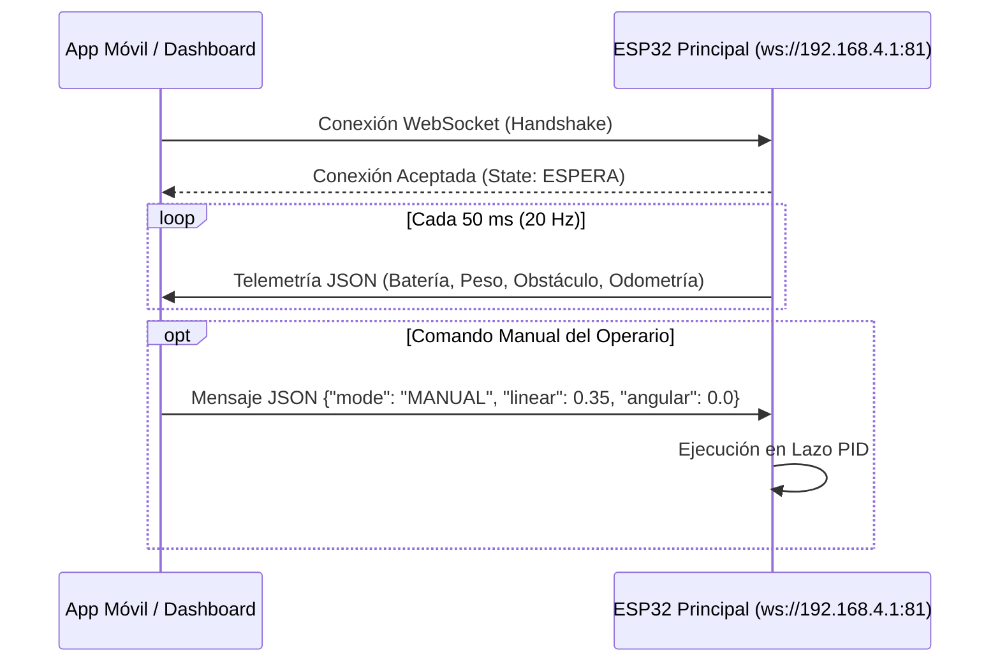

# Aplicación Móvil e Interfaces de Usuario — Proyecto Robot Autónomo

Este directorio contiene las especificaciones, protocolos y recursos para la interfaz de control y la aplicación de usuario del **Proyecto Robot Autónomo (`proyecto-robot-autonomo`)**.

---

## 1. Visión General de la Interfaz

La aplicación de control actúa como el centro de mando del robot móvil en entornos interiores, permitiendo a los operarios supervisar el estado del vehículo en tiempo real y ejecutar maniobras de telemando:

- **Monitoreo de Telemetría en Tiempo Real:**
  - Porcentaje de carga y salud de la batería LiPo.
  - Peso exacto sobre la plataforma superior medido por la celda de carga desacoplada (rango $0.00\text{ kg} - 5.00\text{ kg}$).
  - Alertas visuales de proximidad ante obstáculos detectados por los sensores ToF.
  - Estado de la máquina de estados embebida (`INICIALIZANDO`, `ESPERA`, `MANUAL`, `AUTONOMO`, `EMERGENCIA`).
- **Telemando y Conducción Manual:**
  - Joystick virtual o cruceta direccional para enviar consignas de velocidad lineal ($v$) y velocidad angular ($\omega$).
  - Botón de parada de emergencia de respuesta inmediata ($< 20\text{ ms}$).
  - Función de tara remota para calibrar el cero de la balanza de pesaje.
- **Supervisión de Reconocimiento de Voz:**
  - Visualización del último comando auditivo reconocido por el coprocesador TinyML ESP32-S3 (`avanzar`, `retroceder`, `girar`, `detener`).

---

## 2. Protocolo de Conectividad y Mensajería

La aplicación se comunica directamente con el servidor WebSockets del ESP32 principal sin requerir conexión a internet ni servidores externos:



---

### Especificación de Tramas JSON

#### 1. Telemetría Recibida desde el Robot (Downlink):
```json
{
  "state": "AUTONOMO",
  "battery": 92,
  "weight": 1.75,
  "obstacle": false,
  "speed_linear": 0.35,
  "speed_angular": 0.0,
  "voice_cmd": "avanzar"
}
```

#### 2. Consigna de Movimiento Manual Enviada al Robot (Uplink):
```json
{
  "mode": "MANUAL",
  "linear": 0.30,
  "angular": -1.05
}
```

#### 3. Comando de Calibración / Tara de la Balanza:
```json
{
  "command": "TARE_SCALE"
}
```

---

## 3. Opciones de Desarrollo y Ejecución

La arquitectura de comunicación desacoplada por WebSockets permite ejecutar la interfaz desde múltiples plataformas:

### Opción A: Dashboard Web React (Inmediato)
El proyecto incluye un componente de panel de control listo para usar en [`software/ai_training/script entrenamiento.js`](../software/ai_training/script%20entrenamiento.js):
1. Iniciar un proyecto web liviano con [Vite](https://vitejs.dev/):
   ```bash
   npm create vite@latest robot-dashboard -- --template react
   cd robot-dashboard
   npm install
   ```
2. Importar el componente y conectarse a la red WiFi emitida por el robot (`192.168.4.1`).
3. Iniciar el servidor local:
   ```bash
   npm run dev
   ```

---

### Opción B: Aplicación Nativa Android / Multiplataforma (Flutter / Kotlin)
Para compilar y empaquetar una aplicación móvil APK:
- **Tecnologías soportadas:** Flutter (Dart) con el paquete `web_socket_channel` o Android nativo (Kotlin) con Jetpack Compose y `OkHttp WebSocket`.
- **Permisos requeridos en `AndroidManifest.xml`:**
  ```xml
  <uses-permission android:name="android.permission.INTERNET" />
  <uses-permission android:name="android.permission.ACCESS_NETWORK_STATE" />
  <uses-permission android:name="android.permission.ACCESS_WIFI_STATE" />
  ```
- Al abrir la aplicación en el dispositivo móvil, conectarse a la red WiFi del robot para establecer el enlace bidireccional.
