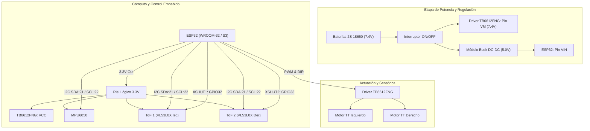

# Documentación y Arquitectura del Sistema — Robot Móvil 2WD

Este directorio centraliza la documentación técnica, especificaciones mecatrónicas y esquemas de conexionado del **Robot Móvil Autónomo 2WD**.

---

## 1. Especificación Técnica en LaTeX

La memoria técnica formal del proyecto se encuentra disponible en formato LaTeX listo para compilar:
- **Archivo fuente:** [`proyecto_robot_2wd.tex`](./proyecto_robot_2wd.tex)
- **Contenido del documento:**
  - Descripción y objetivos operativos del robot (avance rectilíneo estabilizado por giroscopio, evasión reactiva con sensores ToF, frenado de emergencia).
  - Lista de componentes requeridos y estado de inventario (hardware disponible vs por adquirir).
  - Justificación técnica de cada componente (ESP32, TB6612FNG, MPU6050, VL53L0X, Chasis 2WD).

Para compilarlo a PDF en un entorno local con TeX Live:
```bash
pdflatex proyecto_robot_2wd.tex
```
O cargando directamente el archivo `.tex` en plataformas como [Overleaf](https://www.overleaf.com/).

---

## 2. Arquitectura General del Sistema

El robot implementa una arquitectura modular unificada bajo un único microcontrolador ESP32:



---

## 3. Asignación de Pines (Pinout Resumido)

| Periférico | Pin ESP32 | Función |
|---|---|---|
| **Bus I2C** | GPIO 21 (SDA), GPIO 22 (SCL) | Comunicación con MPU6050 (0x68) y ToF (0x30, 0x29) |
| **ToF Izquierdo** | GPIO 32 | Pin `XSHUT` (reasignación dinámica de dirección a 0x30) |
| **ToF Derecho** | GPIO 33 | Pin `XSHUT` (habilitación con dirección por defecto 0x29) |
| **TB6612FNG (Standby)** | GPIO 25 | Pin `STBY` (HIGH = activo) |
| **Motor Izquierdo** | GPIO 18 (PWMA), GPIO 19 (AIN1), GPIO 23 (AIN2) | Control de velocidad (LEDC 20 kHz) y dirección |
| **Motor Derecho** | GPIO 5 (PWMB), GPIO 17 (BIN1), GPIO 16 (BIN2) | Control de velocidad (LEDC 20 kHz) y dirección |
