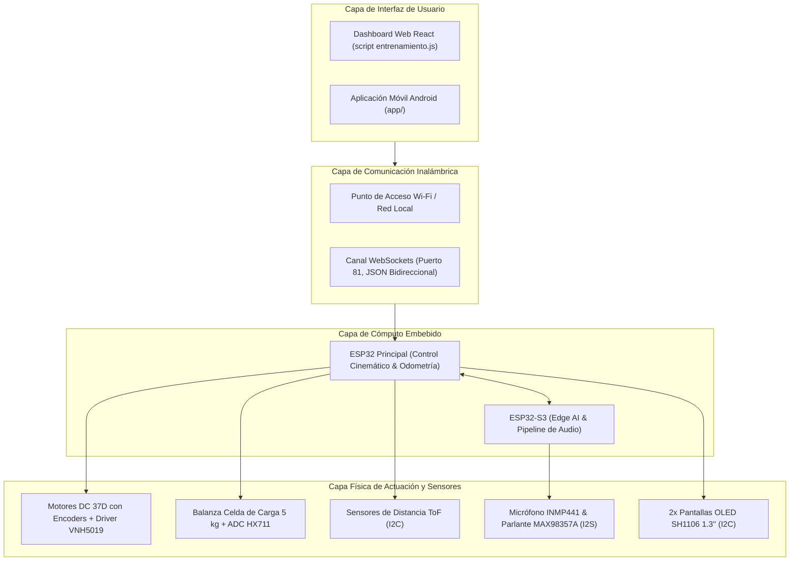

# Documentación Global y Arquitectura del Sistema — Proyecto Robot Autónomo

Este directorio centraliza la documentación arquitectónica, los estándares de comunicación intermodular, los diagramas de bloques funcionales y la matriz de conexionado (pinouts) del **Proyecto Robot Autónomo (`proyecto-robot-autonomo`)**.

---

## 1. Arquitectura General del Sistema

El robot móvil se compone de cuatro capas funcionales estrictamente desacopladas para garantizar robustez, mantenibilidad y facilidad de prueba:



---

## 2. Protocolos de Comunicación

### A. Canal Inalámbrico WebSockets (Telemetría y Control)
- **Servidor:** Instanciado en el ESP32 principal escuchando en el puerto `81` (`ws://192.168.4.1:81/`).
- **Formato de Carga Útil:** JSON comprimido para minimizar latencia en lazo cerrado ($< 20\text{ ms}$).

#### Telemetría Emitida por el Robot hacia la Interfaz:
```json
{
  "state": "AUTONOMO",
  "battery": 88,
  "weight": 2.14,
  "obstacle": false,
  "vx": 0.35,
  "wz": 0.0,
  "odom_x": 1.25,
  "odom_y": 0.42
}
```

#### Comandos de Control Enviados desde la Interfaz hacia el Robot:
```json
{
  "mode": "MANUAL",
  "linear": 0.30,
  "angular": -1.20
}
```

---

### B. Bus Digital de Audio I2S (ESP32-S3)
El procesamiento acústico se realiza mediante un flujo estéreo/mono a $16\text{ kHz}$ con cuantización de 16/32 bits:
- **Entrada (RX - Micrófono MEMS INMP441):** Captura de voz continua en buffer circular DMA para alimentar el extractor MFCC del modelo TinyML.
- **Salida (TX - Amplificador MAX98357A):** Síntesis de tonos auditivos y respuestas acústicas de confirmación.

---

### C. Bus I2C de Percepción y Visualización
- **Frecuencia del Bus:** Fast-Mode a $400\text{ kHz}$.
- **Dispositivos Conectados:**
  - **OLED SH1106 Izquierdo:** Dirección `0x3C` (animación de ojo robótico).
  - **OLED SH1106 Derecho:** Dirección `0x3D` (animación de ojo robótico).
  - **Matriz ToF (4x Sensores VL53L0X):** Multiplexados temporalmente mediante líneas de apagado selectivo (`XSHUT`) para detección perimetral de obstáculos.

---

## 3. Matriz Consolidada de Pines (Hardware Pinout)

### Microcontrolador 1: ESP32 Principal (Control & Cinemática)
| Función / Periférico | Pin GPIO | Modo | Notas Técnicas |
|---|---|---|---|
| **Motor Derecho - PWM** | `GPIO 25` | Salida (LEDC) | Señal de velocidad para Driver VNH5019 |
| **Motor Derecho - Dirección** | `GPIO 26` | Salida Digital | Sentido de giro horario / antihorario |
| **Motor Izquierdo - PWM** | `GPIO 27` | Salida (LEDC) | Señal de velocidad para Driver VNH5019 |
| **Motor Izquierdo - Dirección** | `GPIO 14` | Salida Digital | Sentido de giro horario / antihorario |
| **Encoder Derecho (Canal A/B)** | `GPIO 34 / 35` | Entrada (Pull-up) | Lectura en cuadratura para odometría |
| **Encoder Izquierdo (Canal A/B)** | `GPIO 36 / 39` | Entrada (Pull-up) | Lectura en cuadratura para odometría |
| **Balanza HX711 (DATA)** | `GPIO 32` | Entrada Digital | Datos del conversor de celda de carga |
| **Balanza HX711 (SCK)** | `GPIO 33` | Salida Digital | Pulso de reloj del conversor HX711 |
| **Bus I2C (SDA)** | `GPIO 21` | Bidireccional | Comunicación con pantallas OLED y sensores ToF |
| **Bus I2C (SCL)** | `GPIO 22` | Salida Clock | Reloj de bus a 400 kHz con resistencias de 4.7 kΩ |

---

### Microcontrolador 2: ESP32-S3 (Edge AI & Pipeline de Voz)
| Función / Periférico | Pin GPIO | Modo | Protocolo |
|---|---|---|---|
| **Micrófono INMP441 - BCLK** | `GPIO 4` | Salida Reloj | I2S Bit Clock (RX) |
| **Micrófono INMP441 - WS** | `GPIO 5` | Salida Word | I2S Word Select / L/R Clock (RX) |
| **Micrófono INMP441 - DIN** | `GPIO 6` | Entrada Datos | I2S Serial Data In |
| **Amplificador MAX98357A - BCLK** | `GPIO 15` | Salida Reloj | I2S Bit Clock (TX) |
| **Amplificador MAX98357A - WS** | `GPIO 16` | Salida Word | I2S Word Select / L/R Clock (TX) |
| **Amplificador MAX98357A - DOUT** | `GPIO 7` | Salida Datos | I2S Serial Data Out hacia parlante |
| **Enlace Inter-MCU (UART TX/RX)** | `GPIO 43 / 44` | Serial | Transmisión de comandos detectados al ESP32 |

---

## 4. Documentación Complementaria

Para profundizar en los cálculos estructurales, planos y simulaciones mecánicas, consultar:
- [Memoria Técnica Completa de Ingeniería Mecánica](../hardware/mechanics/docs/MEMORIA_TECNICA.md): 15 módulos analíticos de validación flexional, torsional, térmica y modal.
- [Guía de Simulación en Gazebo Harmonic](../hardware/mechanics/simulation/GUIA_SIMULACION_GAZEBO.md): Procedimiento de ejecución del entorno virtual 3D.
