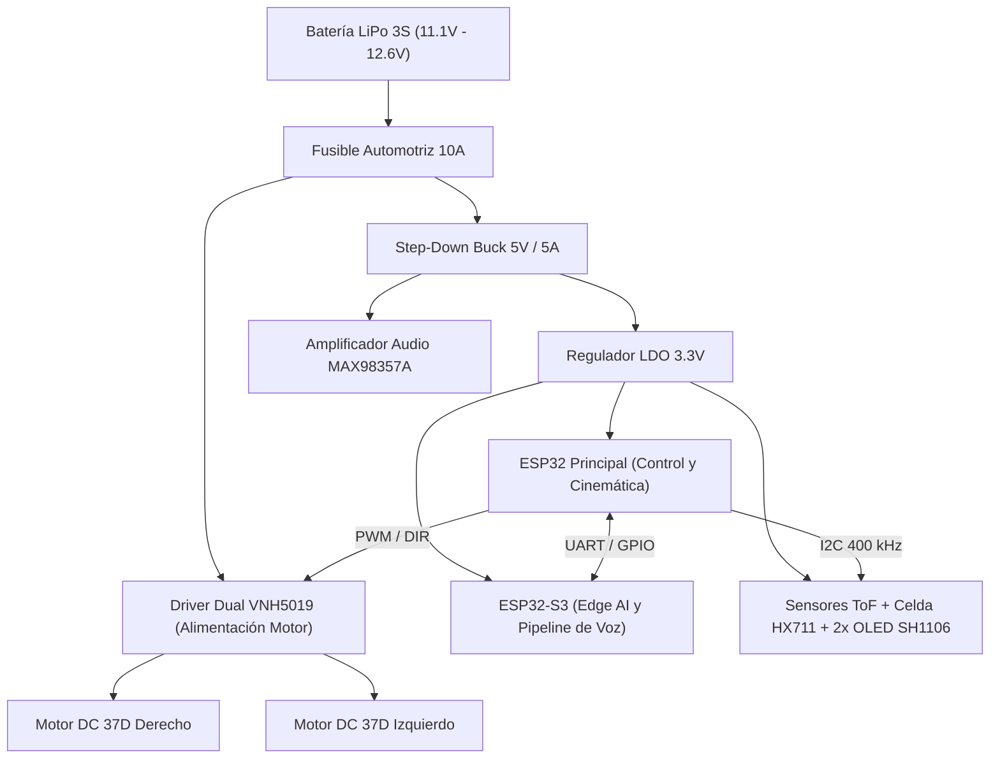

# Arquitectura Electrónica y Distribución de Potencia — Proyecto Robot Autónomo

Este directorio alberga la arquitectura de hardware electrónico, la distribución de potencia, los esquemas de conexionado y las etapas de sensórica y control embebido del **Proyecto Robot Autónomo (`proyecto-robot-autonomo`)**.

---

## 1. Arquitectura del Sistema Eléctrico

La electrónica del robot está diseñada bajo un criterio de **segregación estricta de potencia y señal**, aislando el ruido electromagnético de los motores DC respecto a los microcontroladores y las etapas analógicas de audio y pesaje.

---

## 2. Subsistemas Electrónicos

### A. Etapa de Potencia y Actuadores
- **Fuente de Energía:** Batería LiPo 3S de $2200 - 5000\text{ mAh}$ con conector XT60 y fusible automotriz de $10\text{ A}$ en línea positiva.
- **Controlador de Motores:** Placa driver dual **VNH5019** con capacidad de hasta $12\text{ A}$ continuos por canal (pico de $30\text{ A}$):
  - Control de velocidad mediante señales PWM de alta frecuencia ($20\text{ kHz}$) generadas por el periférico LEDC del ESP32.
  - Líneas digitales independientes de sentido de giro (`DIR`).
  - Diodos de protección flyback integrados y sensado de corriente analógico opcional.

---

### B. Unidad de Cómputo Dual (Dual-MCU Architecture)

1. **ESP32 Principal (Master Controller):**
   - **Misión:** Ejecución de lazo cerrado cinemático diferencial a $50\text{ Hz}$, lectura de encoders por hardware, filtrado digital de la balanza de carga útil y servicio de WebSockets en modo Punto de Acceso (AP).
   - **Conectividad:** Wi-Fi 802.11 b/g/n, WebSockets en puerto 81.
   
2. **ESP32-S3 (Edge AI & Voice Pipeline):**
   - **Misión:** Adquisición de audio digital mono a $16\text{ kHz}$ vía bus I2S, extracción de coeficientes MFCC e inferencia en tiempo real mediante red neuronal convolucional cuantizada (TinyML).
   - **Respuesta:** Activación por palabra clave en $< 200\text{ ms}$ y transmisión de la orden decodificada hacia el ESP32 principal por UART.

---

### C. Cadena de Sensórica y Metrología

| Sensor / Dispositivo | Interfaz | Tensión | Función en el Robot |
|---|---|---|---|
| **Celda de Carga (5 kg)** | Analógica (Puente Wheatstone) + ADC HX711 (24 bits) | $3.3\text{ V} - 5\text{ V}$ | Pesaje dinámico continuo de carga útil en bandeja flotante |
| **4x Sensores ToF (VL53L0X)** | Bus I2C + líneas `XSHUT` | $3.3\text{ V}$ | Detección perimetral de obstáculos y frenado de emergencia |
| **Micrófono MEMS INMP441** | Bus digital I2S (RX) | $3.3\text{ V}$ | Captura omnidireccional de voz para comandos del operario |
| **DAC Amplificador MAX98357A** | Bus digital I2S (TX) | $5\text{ V}$ | Reproducción de audio y confirmación acústica en parlante de 3W |
| **2x Displays OLED SH1106 (1.3")** | Bus I2C (`0x3C`, `0x3D`) | $3.3\text{ V}$ | Ojos robóticos expresivos y visualización de diagnóstico |

---

## 3. Pautas de Montaje y Cableado

1. **Topología de Masa en Estrella (*Star Ground*):** Conectar la masa de potencia (motores y driver) y la masa de señal lógica en un único punto común cerca del terminal negativo de la batería para evitar lazos de corriente que afecten las lecturas del ADC HX711 y el micrófono I2S.
2. **Filtrado y Desacoplo:** Disponer capacitores electrolíticos de $470\ \mu\text{F} / 25\text{ V}$ en la entrada de alimentación del driver de motores y cerámicos de $100\text{ nF}$ cerca de los pines de alimentación de cada microcontrolador.
3. **Cables de Encoder:** Utilizar cable trenzado apantallado para las señales de los encoders de los motores 37D para prevenir falsos pulsos inducidos por el PWM motriz.

---

## 4. Software de Diseño y Apertura de Esquemáticos

Para diseñar, auditar o exportar los circuitos impresos (PCBs) y diagramas esquemáticos del robot:
- **Herramienta recomendada:** [KiCad EDA](https://www.kicad.org/) (versión $\ge 7.0$ u $8.0$).
- Las reglas de diseño IPC-2221 sugieren pistas de potencia con un ancho mínimo de $2.5\text{ mm}$ (cobre 1 oz) para soportar las corrientes de bloqueo de los motores DC 37D.
