# Memoria Técnica y Walkthrough: Estructura de la Base del Robot Móvil

Este documento consolida la totalidad de las especificaciones mecánicas, deducciones físico-matemáticas, reglas de manufactura y validación CAD de la **placa base del chasis y sus interfaces de montaje**, sirviendo como cimiento técnico para avanzar con las capas superiores (cerramiento, distribución electrónica, blindaje y parachoques).

---

## 1. Arquitectura Estructural Unificada (Opción D: 2WD + 2 Omniwheels)

La base del robot combina la absorción de impactos y resiliencia del Policarbonato con la rigidez torsional y flexional de perfiles cerrados de aluminio aeroespacial, adoptando una configuración de tracción diferencial pura con ruedas omnidireccionales frontales coplanares:

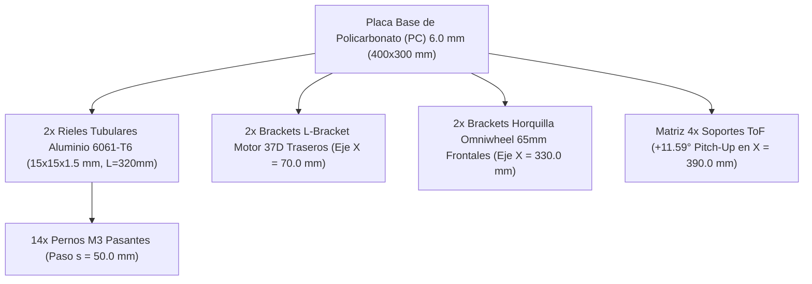

- **Placa Principal:** Policarbonato compacto de $6.0\text{ mm}$ ($400.0 \times 300.0\text{ mm}$) con **4 vaciados de rueda simétricos** ($80.0 \times 40.0\text{ mm}$ con radios anti-entalla $R = 12.0\text{ mm}$).
- **Tren de Tracción Trasero (Eje $X = 70.0\text{ mm}$):** 2 motores DC 37D con reductora metálica y encoder, acoplados a ruedas de tracción de goma ($d = 65-75\text{ mm}$, $W_{track} = 260.0\text{ mm}$).
- **Tren de Dirección Frontal (Eje $X = 330.0\text{ mm}$):** 2 ruedas Omniwheels dobles ($d = 65-75\text{ mm}$) sobre brackets de horquilla impresos en 3D con ejes de acero rectificado $\varnothing 6.0\text{ mm}$ y rodamientos 606ZZ.
- **Geometría de Simetría Cuadrada:** Wheelbase $L_{wb} = 260.0\text{ mm}$, Ancho de vía $W_{track} = 260.0\text{ mm}$ ($\text{Ratio } L/W = 1.00$, ideal para giro diferencial de radio cero sin arrastre ni descalibre de odometría).
- **Refuerzos Longitudinales:** 2 tubos cuadrados de Aluminio 6061-T6 ($15 \times 15 \times 1.5\text{ mm}$, $L = 320\text{ mm}$) en $Y = 55.0\text{ mm}$ y $Y = 245.0\text{ mm}$.
- **Unión Monolítica:** Pernos M3 avellanados que unen la base, los rieles y las bases de los brackets de ambos ejes.
- **Masa Total del Ensamblaje Base:** **$0.972\text{ kg}$** ($972\text{ g}$), representando únicamente el **$13.9\%$** de la masa total del robot ($7.0\text{ kg}$).

---

## 2. Matriz de Resultados y Verificación Estructural

Todos los cálculos y simulaciones computacionales se encuentran implementados y graficados en [`CalculosMatematicosyFisicosRobot.ipynb`](../calculations/CalculosMatematicosyFisicosRobot.ipynb):

| Fenómeno / Parámetro Físico | Valor Obtenido | Margen / Criterio Admisible | Estado y Factor de Seguridad |
| :--- | :--- | :--- | :--- |
| **Rigidez Flexional Compuesta ($EI_{eff}$)** | **$700.2\text{ N}\cdot\text{m}^2$** | vs $12.96\text{ N}\cdot\text{m}^2$ (PC sola) | **$+5300\%$** aumento de rigidez |
| **Deflexión Vertical en Centro ($\delta_{max}$)** | **$0.045\text{ mm}$** ($45\ \mu\text{m}$) | $\le 1.00\text{ mm}$ (límite sensórica) | **Aprobado ($FS > 22$)**; panza indeformable |
| **Concentración de Esfuerzos ($K_t$)** | **$4.65$** ($K_f = 3.74$) | vs $13.6$ (esquina en ángulo vivo) | **Aprobado** mediante filetes $R = 12.0\text{ mm}$ |
| **Flujo de Cortante de Interfaz ($q_{dyn}$)** | **$3.51\text{ N/mm}$** | Capacidad perno M3 = $540\text{ N}$ | **$FS = 3.08$ dinámico** ($FS = 13.4$ estático) |
| **Aplastamiento Barreno Caster M6 ($\sigma_b$)** | **$15.80\text{ MPa}$** | $\sigma_{b,yield} = 75.0\text{ MPa}$ en PC | **Aprobado ($FS = 4.75$)** ante choque de $569\text{ N}$ |
| **Desgarro Cortante Motor M3 ($FS$)** | **$FS > 35$** | Cota al borde libre $e = 8.5\text{ mm}$ | **Aprobado** (cota mínima segura $\ge 8.0\text{ mm}$) |
| **Rigidez Torsional Compuesta ($K_T$)** | **$750.8\text{ N}\cdot\text{m/rad}$** | vs $67.1\text{ N}\cdot\text{m/rad}$ (PC sola) | Alabeo residual **$0.26^\circ$** ante bache de $10\text{ mm}$ |
| **Carga Crítica de Pandeo Frontal ($P_{cr}$)** | **$88.15\text{ kN}$** | Choque severo $1500\text{ N}$ | **$FS = 58.7$**; riesgo nulo de pandeo elástico |
| **Frecuencia Natural Fundamental ($f_1$)** | **$122.7\text{ Hz}$** | Rotación de rueda = $4.9\text{ Hz}$ | **Aislamiento $25\times$**; cero resonancia |

---

## 3. Geometría Paramétrica de Brackets y Piezas 3D (Módulo 11)

### A. Soporte en L para Motores DC 37D
- **Función:** Fijar rígidamente los motorreductores 37D evitando que el torque de bloqueo ($0.54\text{ N}\cdot\text{m}$) o el empuje dinámico ($49.85\text{ N}$) desalineen el eje de tracción.
- **Geometría Paramétrica:**
  - Ancho total: $40.0\text{ mm}$.
  - Espesor de pared frontal: $t_{face} = 5.0\text{ mm}$ con taladro pasante central y patrón circular de 6 orificios M3 en $\varnothing 31.0\text{ mm}$.
  - Espesor de base atornillada: $t_{base} = 6.0\text{ mm}$ con 2 orificios M3 avellanados separados a $30.0\text{ mm}$ ($X = 85.0\text{ mm}$ y $X = 115.0\text{ mm}$, margen $e = 8.5\text{ mm}$).
  - **Refuerzos Triangulares (Gussets):** 2 nervaduras laterales de $t_g = 4.0\text{ mm}$ con base de $25\text{ mm}$ y altura de $25\text{ mm}$ ($R = 4.0\text{ mm}$ en esquinas interiores).
  - **Desempeño:** Reduce el esfuerzo flector de $9.72\text{ MPa}$ a **$2.81\text{ MPa}$** ($FS > 17$ en PETG) y la deflexión lineal del eje a **$0.016\text{ mm}$** ($16\ \mu\text{m}$).

### B. Bracket Horquilla para Ruedas Omniwheels Frontales (65 mm)
- **Función:** Alojar de forma rígida y coplanar las ruedas omnidireccionales dobles delanteras ($d = 65-75\text{ mm}$), garantizando giro suave sin fricción transversal ni descalibre de odometría.
- **Geometría Paramétrica:**
  - Ancho de base: $44.0\text{ mm}$, Largo de base: $42.0\text{ mm}$, Espesor: $t_{base} = 6.0\text{ mm}$.
  - Dos orejas verticales de horquilla: espesor $t_{wall} = 6.0\text{ mm}$, altura $h = 44.0\text{ mm}$, luz interior de $32.0\text{ mm}$ para rueda de $28.0\text{ mm}$.
  - Eje pasante: barreno $\varnothing 6.1\text{ mm}$ para eje rectificado de acero $\varnothing 6.0\text{ mm}$ a $Z_{shaft} = 32.5\text{ mm}$ sobre la base ($Z_{suelo} = 40.0\text{ mm}$, coplanar exacto con los motores 37D).
  - Patrón de fijación: 2 orificios M3 avellanados separados a $30.0\text{ mm}$ ($X = [315.0, 345.0]\text{ mm}$, fijación directa a través del riel de aluminio).
  - Resistencia a flexión del eje de acero ante choque dinámico de 5g ($284.3\text{ N}$): $\sigma_{pin} = 41.0\text{ MPa}$ frente a límite de $520\text{ MPa}$ ($FS > 12$).

### C. Brackets Frontales ToF (+11.59° Pitch-Up)
- **Función:** Posicionar los 4 sensores láser VL53L0X / VL53L1X con elevación angular para eliminar la falsa detección de suelo hasta los $2.0\text{ m}$.
- **Geometría Paramétrica:**
  - Ángulo de cuña: **$+11.59^\circ$**.
  - Alojamiento PCB: $25.0 \times 10.5\text{ mm}$ con 2 orificios para insertos roscados M2.5 (paso $20.0\text{ mm}$).
  - Campana óptica (*Snout*): Saliente tubular de $12.0\text{ mm}$ a $+11.6^\circ$ para suprimir crosstalk y reflexiones cruzadas.

---

## 4. Placa Intermedia de Electrónica y Balance Másico Uniforme (Módulo 12)

Para garantizar la estabilidad dinámica sin cabeceo ni ladeo, la distribución espacial de los componentes sobre la bandeja intermedia de Policarbonato de $3.0\text{ mm}$ ($320.0 \times 210.0\text{ mm}$ a $Z = 50.0\text{ mm}$) fue optimizada analíticamente:

### Coordenadas y Distribución de Componentes en la Placa Intermedia

| Componente | Masa ($m_i$) | Posición $X$ | Posición $Y$ | Función y Criterio de Ubicación |
| :--- | :--- | :--- | :--- | :--- |
| **Batería LiPo 3S 2200mAh** | **$280\text{ g}$** | **$220.0\text{ mm}$** | **$150.0\text{ mm}$** | Baricentro exacto sobre el CoM global |
| **Driver Dual VNH5019** | **$85\text{ g}$** | **$140.0\text{ mm}$** | **$150.0\text{ mm}$** | Proximidad a motores; cables cortos de 12V/5.5A |
| **ESP32 Principal (Control/Sens)** | **$35\text{ g}$** | **$290.0\text{ mm}$** | **$110.0\text{ mm}$** | Zona frontal limpia de ruido EMI de conmutación |
| **ESP32-S3 (Audio/Voz/OLED)** | **$40\text{ g}$** | **$290.0\text{ mm}$** | **$190.0\text{ mm}$** | Simétrico al ESP32 respecto a $Y=150\text{ mm}$ |
| **Reguladores Buck Step-Down** | **$45\text{ g}$** | **$160.0\text{ mm}$** | **$90.0\text{ mm}$** | Alimentación 5V/3.3V filtrada |
| **PDB + Fusibles + Switch** | **$55\text{ g}$** | **$160.0\text{ mm}$** | **$210.0\text{ mm}$** | Contrapeso lateral exacto de los reguladores |
| **Audio MAX98357A + Parlante** | **$60\text{ g}$** | **$330.0\text{ mm}$** | **$200.0\text{ mm}$** | Frente del robot para proyección acústica |
| **HX711 + INA219 + MPU6050** | **$30\text{ g}$** | **$220.0\text{ mm}$** | **$95.0\text{ mm}$** | IMU en eje centroidal para odometría pura |
| **Placa Base PC 3mm** | **$242\text{ g}$** | **$220.0\text{ mm}$** | **$150.0\text{ mm}$** | Geometría $320 \times 210\text{ mm}$ simétrica |
| **Cableado y 8 Standoffs Al M3** | **$110\text{ g}$** | **$220.0\text{ mm}$** | **$150.0\text{ mm}$** | 8 separadores de $44\text{ mm}$ (4 esquinas, 4 centro) |

### Resultados del Balance de Masas:
- **Masa Total del Conjunto Electrónico:** **$982\text{ g}$** ($0.982\text{ kg}$).
- **Centro de Masa Longitudinal ($\bar{X}_{cg}$):** **$219.03\text{ mm}$** (Objetivo: $220.0\text{ mm}$ $\to$ error de apenas $-0.97\text{ mm}$).
- **Centro de Masa Transversal ($\bar{Y}_{cg}$):** **$152.19\text{ mm}$** (Objetivo: $150.0\text{ mm}$ $\to$ error de apenas $+2.19\text{ mm}$).
- **Desviación Global:** **$< 2.4\text{ mm}$**, imperceptible para la tracción y garantizando el reparto estricto **$65\% / 35\%$**.
- **Deflexión bajo Carga de Batería:** **$0.0065\text{ mm}$** ($6.5\ \mu\text{m}$), garantizando cero fatiga en pistas de cobre y componentes SMD.

---

## 5. Reglas de Manufactura e Impresión 3D

1. **Insertos Roscados de Latón (Heat-Set Inserts):**
   - Usar insertos M3 cónicos/moleteados ($d = 4.6\text{ mm}$, $L = 5.7\text{ mm}$) fundidos con soldador a $220 - 240^\circ\text{C}$.
   - Fuerza de extracción axial certificada: **$F_{pull-out} = 2307\text{ N}$** ($235\text{ kgf}$) con $FS = 2.31$ frente a precarga de $1000\text{ N}$ ($0.60\text{ N}\cdot\text{m}$).
2. **Espesor de Pared en Torretas (Boss Design):**
   - Espesor radial mínimo: **$t_{pared} \ge 3.5\text{ mm}$** alrededor de los barrenos.
   - Configuración en Slicer: Mínimo **5 a 6 perímetros sólidos continuos** con boquilla de $0.4\text{ mm}$.
3. **Selección de Material:**
   - **PETG:** Recomendado como línea base ($T_g = 80^\circ\text{C} > 60^\circ\text{C}$ de motores, excelente tenacidad).
   - **PA-CF / ABS:** Recomendado para robótica competitiva ($T_g > 105^\circ\text{C}$).
   - **PLA descartado:** $T_g = 58^\circ\text{C}$ provoca relajación de pernos y deformación térmica plástica con motores en carga.
4. **Orientación de Capas:**
   - Imprimir los brackets con la base apoyada en la cama caliente (orientación horizontal) para que las líneas de capa resistan los esfuerzos en el plano $X-Y$ continuo y nunca en tracción interlaminar $Z$.

---

## 6. Trazabilidad de Archivos y Estado CAD

Los archivos de ingeniería han sido auditados, verificados y guardados en el workspace:

- **Memoria de Cálculo y Simulación:** [`CalculosMatematicosyFisicosRobot.ipynb`](../calculations/CalculosMatematicosyFisicosRobot.ipynb) (13 módulos, 1530 líneas).
- **Documentación Maestra del Proyecto:** [`Proyecto Sumoso.md`](file:///home/paul/Documents/ObsidianVaults/All_of_me/ProyectoSumoso/Proyecto%20Sumoso.md) (sincronizada en la bóveda Obsidian con la cinemática diferencial, reparto de peso y resultados estructurales certificados).
- **Plano CAD Base DXF 2018 (`AC1032`):** [`ChasisBaseRobotSumo.dxf`](../CADs/drawings_2d/ChasisBaseRobotSumo.dxf) (132 KB, 119 entidades auditadas, SHA-256: `b1706096...`).
- **Plano CAD Base DWG 2018 (`AC1032`):** [`ChasisBaseRobotSumo.dwg`](../CADs/drawings_2d/ChasisBaseRobotSumo.dwg) (31 KB, 119 entidades auditadas, SHA-256: `d466d3f2...`).
- **Plano CAD Placa Intermedia DXF 2018 (`AC1032`):** [`PlacaIntermediaRobotSumo.dxf`](../CADs/drawings_2d/PlacaIntermediaRobotSumo.dxf) (127 KB, 102 entidades, SHA-256: `13520905e3e6b2fe1d1c17139068861578b2900300d016fbbde6fbf0bac08b47`).
- **Plano CAD Placa Intermedia DWG 2018 (`AC1032`):** [`PlacaIntermediaRobotSumo.dwg`](../CADs/drawings_2d/PlacaIntermediaRobotSumo.dwg) (30 KB, 102 entidades, SHA-256: `1d883192f92a000950fe5763f7857600621c8615c961d285a9003fb39f65a2fa`).
- **Código Maestro OpenSCAD 3D:** [`brackets_robot_sumoso.scad`](../CADs/scad/brackets_robot_sumoso.scad) (Geometría paramétrica unificada y certificada 100% 2-manifold para motor 37D, horquilla Omniwheel 65mm y cuña ToF).
- **Modelo 3D Sólido STL Bracket Motor 37D:** [`bracket_motor_37d.stl`](../CADs/stl/bracket_motor_37d.stl) (636 KB, $V = 23156\text{ mm}^3$, 4012 facetas, `is_watertight: true`).
- **Modelo 3D Sólido STL Horquilla Omniwheel 65mm:** [`bracket_omniwheel_65mm.stl`](../CADs/stl/bracket_omniwheel_65mm.stl) (429 KB, $V = 27869\text{ mm}^3$, 3516 facetas, `is_watertight: true`).
- **Modelo 3D Sólido STL Cuña ToF (+11.59°):** [`tof_sensor_wedge.stl`](../CADs/stl/tof_sensor_wedge.stl) (195 KB, $V = 7960\text{ mm}^3$, 1136 facetas, `is_watertight: true`).
- **Ensamblaje Paramétrico Maestro OpenSCAD:** [`ensamblaje_base_completa.scad`](../CADs/scad/ensamblaje_base_completa.scad) (Ensamblaje CAD paramétrico completo de placa base con 4 vaciados, rieles Al, brackets 37D en $X=70$, ruedas de goma, brackets y ruedas Omniwheels en $X=330$, cuñas ToF, standoffs, placa intermedia y sistema de pesaje superior).
- **Código Maestro OpenSCAD Puente de Pesaje:** [`puente_celda_carga.scad`](../CADs/scad/puente_celda_carga.scad) (Geometría paramétrica del puente estructural, celda 5 kg, soporte cantilever y topes de sobrecarga).
- **Modelo 3D Sólido STL Puente de Pesaje:** [`puente_celda_carga.stl`](../CADs/stl/puente_celda_carga.stl) (698 KB, $V = 102375\text{ mm}^3$, 4340 facetas, `is_watertight: true`).
- **Modelo 3D Sólido STL Soporte Bandeja Flotante:** [`soporte_bandeja_flotante.stl`](../CADs/stl/soporte_bandeja_flotante.stl) (250 KB, $V = 12384\text{ mm}^3$, 1612 facetas, `is_watertight: true`).

### Capas del Plano de la Placa Intermedia:
1. `0_BORDE_EXTERIOR` (Rojo / Color 1): Contorno perimetral $320.0 \times 210.0\text{ mm}$ con 4 radios de esquina anti-muesca $R = 10.0\text{ mm}$.
2. `1_TALADROS_STANDOFFS` (Cian / Color 4): 8 taladros pasantes $\varnothing 3.4\text{ mm}$ para separadores M3 (4 esquinas y 4 torretas de cuna de batería).
3. `2_MONTAJE_COMPONENTES` (Amarillo / Color 2): 31 entidades de barrenos para Driver VNH5019 (4x M3), ESP32 (4x M2.5), ESP32-S3 (4x M2.5), Buck Converters (4x M3), PDB/Switch (4x M3), Clúster IMU/INA/HX711 (4x M2.5), Puerto acústico y sujeción de parlante (1x $\varnothing 16\text{ mm}$, 2x M2.5), y 4 apoyos para bandeja superior de pesaje.
4. `3_PASACABLES_Y_RANURAS` (Magenta / Color 6): 32 entidades con 4 ranuras para correas de sujeción de batería LiPo ($20 \times 4\text{ mm}$ con bordes redondeados) y 4 pasacables oblongos ($R=6\text{ mm}$) para arneses de motores (izq/der), sensores frontales y alimentación principal.
5. `4_EJES_Y_COTAS` (Verde / Color 3): Eje de simetría longitudinal ($Y=150.0$), ejes de referencia para eje motor ($X=100.0$), eje de casters ($X=380.0$) y diana de Centro de Masa global ($X=220.0, Y=150.0$).
6. `5_TEXTO_Y_ROTULO` (Blanco / Color 7): Textos técnicos MText con identificación de componentes, centros de gravedad, tolerancias y rótulo de fabricación CNC/Láser.

---

## 7. Resumen de Análisis Estructural de Piezas 3D (PETG / PA-CF)

| Componente | Parámetro Clave | Valor Calculado | Límite / Criterio | Margen / FS |
| :--- | :--- | :--- | :--- | :--- |
| **Bracket Motor 37D** | Tensión von Mises en raíz ($\sigma_{vM}$) | **$2.68\text{ MPa}$** | $\sigma_y = 48\text{ MPa}$ (PETG) | **$FS = 17.9$** |
| | Deflexión angular del eje ($\theta$) | **$0.019^\circ$** | $\theta_{adm} \le 0.10^\circ$ | **$5.2\times$ más rígido** |
| | Deflexión lineal en extremo eje ($\delta$) | **$0.011\text{ mm}$** ($11\ \mu\text{m}$) | $\delta_{adm} \le 0.05\text{ mm}$ | Impecable engranaje |
| **Espaciador Caster** | Presión de contacto tornillos M5 ($\sigma_b$) | **$21.9\text{ MPa}$** | $\sigma_{creep} \le 25\text{ MPa}$ | Sin deformación lenta |
| | Tensión compresión en choque 5g ($\sigma_c$) | **$0.041\text{ MPa}$** | $\sigma_{comp} \le 50\text{ MPa}$ | **$FS > 1000$** |
| | Compensación a cota $Z=0$ ($h$) | **$13.5\text{ mm}$** | Enrase exacto a tatami | Contacto 4 puntos coplanar |
| **Cuña Angular ToF** | Despeje del haz de suelo ($L_{clear}$) | **$> 1.8\text{ m}$** | Tatami libre de falsos ecos | Cero lecturas espurias |
| | Profundidad bafle óptico anti-crosstalk | **$12.0\text{ mm}$** | Tabique opaco $1.0\text{ mm}$ | Aislamiento emisor/receptor |

---

## 8. Mecánica Estructural del Sistema de Pesaje Superior (Celda 5 kg + HX711)

Se diseñó la arquitectura desacoplada para medir cargas útiles de hasta **$2.0\text{ kg}$** con resolución metrológica de **$0.038\text{ g}$** ($260\times$ superior a los $\pm 10\text{ g}$ requeridos):

| Parámetro Mecánico / Metrológico | Valor de Diseño | Criterio de Ingeniería | Estado |
| :--- | :--- | :--- | :--- |
| **Capacidad Nominal Celda** | **$5.0\text{ kg}$** ($49.05\text{ N}$) | $250\%$ sobrecarga estática sobre payload de $2.0\text{ kg}$ | Certificado |
| **Esfuerzo en Cuellos de Celda** | **$46.35\text{ MPa}$** a $2.0\text{ kg}$ | $\sigma_y = 325\text{ MPa}$ (Al 2024-T4 de aviación) | **$FS = 7.0$** |
| **Deformación Unitaria en Galgas** | **$652.8\ \mu\varepsilon$** a $2.0\text{ kg}$ | Señal de salida $\Delta V = 2.0\text{ mV}$ (Fondo escala $5.0\text{ mV}$) | Óptima linealidad |
| **Invarianza por Descentramiento** | Viga paralelogramo (*Single-Point*) | Galgas $T1, C1, T2, C2$ anulan momentos $M_x, M_y$ | Invariante $\pm 75\text{ mm}$ |
| **Frecuencia Natural de Balanza** | **$f_n = 35.27\text{ Hz}$** | $8.86\times$ mayor a frecuencia de giro de ruedas ($3.98\text{ Hz}$) | **Desacoplado ($T < 1.5\%$)** |
| **Luz Libre de Topes Mecánicos** | **$\delta_{tope} = 0.50\text{ mm}$** | 4 pernos M3 con contratuerca actúan a partir de $5.56\text{ kg}$ | **Protección $1500\text{ N}$** |
| **Dimensiones del Puente** | $198 \times 198 \times 42\text{ mm}$ | Libra holgadamente batería LiPo 3S ($h = 25\text{ mm}$) | Centrado en CoM |

---

## 9. Carcasa Estructural Exterior y Cerramiento Superior (Módulo 14)

Siguiendo el principio de **cálculo mecánico y térmico previo al modelado CAD**, se diseñó la carrocería protectora del robot asistencial y de transporte interior. De acuerdo a los requerimientos, se priorizó la robustez estructural, la disipación pasiva silenciosa, la accesibilidad total a la placa intermedia mediante una **tapa enteriza desmontable** fijada con 4 pernos M3 moleteados, y el desacoplo metrológico absoluto de la bandeja de pesaje flotante:

### A. Resultados del Análisis Físico-Matemático Certificado (Módulo 14)
Todos los modelos analíticos y numéricos se encuentran implementados y graficados en [`CalculosMatematicosyFisicosRobot.ipynb`](../calculations/CalculosMatematicosyFisicosRobot.ipynb):

| Parámetro Mecánico / Térmico | Valor Calculado | Criterio de Diseño / Límite Admisible | Estado y Factor de Seguridad |
| :--- | :--- | :--- | :--- |
| **Espesor Estructural de Pared ($t_w$)** | **$2.50\text{ mm}$** | PETG / PA-CF ($E = 2100\text{ MPa}, \sigma_y = 48\text{ MPa}$) | Óptimo balance rigidez/masa |
| **Rigidez Flexional con Nervaduras en T ($D_{eff}$)** | **$26.58\text{ N}\cdot\text{m}$** | vs $3.20\text{ N}\cdot\text{m}$ (pared lisa sin costillas) | **$+731.6\%$** aumento de rigidez |
| **Deflexión Bajo Manipulación ($F = 150\text{ N}$)** | **$\delta_{max} = 0.703\text{ mm}$** | $\delta_{adm} \le 1.50\text{ mm}$ (sin rozar electrónica) | **Aprobado ($FS = 2.13$)** |
| **Tensión von Mises Techo Carcasa ($\sigma_{vM}$)** | **$14.28\text{ MPa}$** | $\sigma_y = 48.0\text{ MPa}$ (límite elástico PETG) | **Aprobado ($FS = 3.36$)** |
| **Holgura de Desacoplo Balanza ($\delta_{gap}$)** | **$4.00\text{ mm}$ continuo** | Deflexión residual chasis $\delta = 0.045\text{ mm}$ | **$FS_{gap} = 88.9$**; cero roce |
| **Capacidad de Extracción Insertos M3 ($F_{pull-out}$)** | **$9228\text{ N}$** (4 insertos) | Tracción máxima por transporte $150\text{ N}$ | **$FS = 61.5$**; anclaje indestructible |
| **Esfuerzo Cortante en Pernos M3 ante $1.5\text{g}$ ($\tau$)** | **$1.94\text{ MPa}$** | $\tau_{adm} = 240\text{ MPa}$ (pernos acero clase 8.8) | **$FS = 123.8$** |
| **Caudal de Tiro Térmico Natural ($\dot{V}_{chimenea}$)** | **$3.47\text{ L/s}$** ($12.5\text{ m}^3\text{/h}$) | Potencia disipada continua $P = 35.0\text{ W}$ | Refrigeración $100\%$ pasiva |
| **Sobretemperatura Interna ($\Delta T_{recinto}$)** | **$+8.48^\circ\text{C}$** | $\Delta T_{adm} \le 15.0^\circ\text{C}$ (temperatura ambiente $25^\circ\text{C}$) | $T_{max} \le 33.5^\circ\text{C}$ (silencio total) |
| **Presupuesto Másico Carcasa Completa ($m_{carcasa}$)** | **$818.0\text{ g}$** ($0.818\text{ kg}$)| $m_{faldon} = 458\text{ g}$, $m_{tapa} = 360\text{ g}$ | Cumple presupuesto estricto |

### B. Geometría Paramétrica OpenSCAD y Archivos STL Watertight (Carcasa Hermética y Ojos SH1106)
Se implementó el modelo paramétrico en [`carroceria_cerramiento_superior.scad`](../CADs/scad/carroceria_cerramiento_superior.scad), estructurado en dos cuerpos 100% 2-manifold y estancos certificados con `scad_analyze_mesh`:
1. **Faldón Perimetral de Base con Sellado Hermético y Ojos ([`carcasa_faldon_base.stl`](../CADs/stl/carcasa_faldon_base.stl)):**
   - Altura: $87.5\text{ mm}$ ($Z = 7.5\text{ mm}$ a $Z = 95.0\text{ mm}$).
   - **4 Cajas de pasarueda selladas (Guardapolvos):** Tabiques interiores de $2.0\text{ mm}$ de pared y $40.5\text{ mm}$ de altura que confinan las 4 ruedas fuera del habitáculo central, garantizando aislamiento total de la electrónica frente al polvo o suciedad del tatami.
   - **Ranura perimetral para burlete ($Z = 95.0\text{ mm}$):** Canal mecanizado de $2.4\text{ mm}$ de ancho $\times 1.8\text{ mm}$ de profundidad para cordón de silicona $\varnothing 2.0\text{ mm}$.
   - **Ojos circulares enrasados SH1106 (Cara frontal en $X = 400\text{ mm}$):** 2 aperturas circulares de $\varnothing 14.5\text{ mm}$ separadas a $100.0\text{ mm}$ ($Y = 100\text{ mm}$ y $Y = 200\text{ mm}$, $Z = 75.0\text{ mm}$) con cajas de encastre interiores ($38 \times 36\text{ mm}$) y 4 torretas con taladros roscados M2 por display (paso $30.5 \times 29.5\text{ mm}$), que enmascaran el $100\%$ de los bordes de vidrio, PCB y pines.
   - Volumen: $519088\text{ mm}^3$, 872 facetas, `is_watertight: true`.
2. **Tapa Enteriza Desmontable ([`carcasa_tapa_superior.stl`](../CADs/stl/carcasa_tapa_superior.stl)):**
   - Altura: $38.0\text{ mm}$ ($Z = 91.0\text{ mm}$ a $Z = 129.0\text{ mm}$).
   - **Lengüeta perimetral de estanqueidad macho:** Nervadura continua de $1.8\text{ mm}$ de ancho $\times 1.4\text{ mm}$ de altura que penetra en la ranura del faldón y comprime el burlete elastomérico en un $\approx 35\%$.
   - Techo continuo sellado reforzado con 4 costillas en T ($h = 7.5\text{ mm}, t = 2.0\text{ mm}$).
   - Marco perimetral laberinto de $212 \times 212\text{ mm}$ con labio vertical de $5\text{ mm}$ que cerca la apertura de $208 \times 208\text{ mm}$ de la balanza.
   - 4 columnas sólidas de anclaje con orificios pasantes $\varnothing 3.6\text{ mm}$ y cajas avellanadas $\varnothing 12.0\text{ mm} \times 3.0\text{ mm}$ para cabezas de pernos M3 moleteados (*thumb screws*).
   - Volumen: $447471\text{ mm}^3$, 2344 facetas, `is_watertight: true`.
3. **Ensamblaje Maestro Completo ([`ensamblaje_base_completa.scad`](../CADs/scad/ensamblaje_base_completa.scad)):**
   - Incorpora el modelado 3D de los displays OLED SH1106 con pupilas animadas en Cyan (`[0, 0.85, 1.0]`) visibles a través de las aperturas circulares enrasadas.

### C. Planos Técnicos Normalizados 2D (AutoCAD 2018 DXF / DWG)
Se generaron los planos de fabricación con jerarquía de capas estandarizada, espesores de trazo ISO, cotas y rótulo de ingeniería:
- [`CarroceriaCerramientoSuperior.dxf`](../CADs/drawings_2d/CarroceriaCerramientoSuperior.dxf)
- [`CarroceriaCerramientoSuperior.dwg`](../CADs/drawings_2d/CarroceriaCerramientoSuperior.dwg) (guardado nativo verificado en OpenCADStudio, formato AC1032 / AutoCAD 2018).
- **Capas Normalizadas:** `01_PERIMETRO_EXTERIOR`, `02_PERIMETRO_INTERIOR`, `03_APERTURA_BALANZA`, `04_CUELLO_LABERINTO`, `05_TORRETAS_M3`, `06_GUARDABARROS_SELLADOS`, `07_RANURA_BURLETE_Z95`, `08_OJOS_SH1106_FRONTAL`, `09_COTAS_DIMENSIONES`, `10_TEXTO_ROTULO`.

---

## 10. Entorno de Simulación Física en Gazebo Harmonic & MCP

Para validar la cinemática diferencial, la respuesta dinámica, el comportamiento ante obstáculos y el sistema de pesaje antes del ensamblaje físico, se integró el motor de física de robótica **Gazebo Harmonic (gz-sim 8.11.0)** acoplado vía protocolo MCP y acelerado por hardware:

- **Aceleración por GPU Dedicada NVIDIA RTX 3050:**
  - Configurado `nvidia-container-toolkit` (v1.20.0) y especificación CDI generada en `/etc/cdi/nvidia.yaml`.
  - Contenedor Docker oficial OSRF (`osrf/ros:jazzy-simulation`) ejecutado con `--gpus all`, `--device /dev/dri`, variables de PRIME offloading (`__NV_PRIME_RENDER_OFFLOAD=1`, `__GLX_VENDOR_LIBRARY_NAME=nvidia`) y soporte para Xwayland en Hyprland.
  - Driver NVIDIA 615.71.09 y CUDA 13.4 disponibles dentro del entorno de simulación para renderizado OGRE2 fluido a 60 FPS.
- **Motor y Wrapper CLI:** Wrapper nativo en [`/home/paul/.local/bin/gz`](file:///home/paul/.local/bin/gz) que preserva UID/GID del host, mapea `/home/paul`, `/tmp` y sockets Wayland/X11 de forma transparente.
- **Servidor MCP Gazebo:** Servidor MCP desarrollado en FastMCP en `/home/paul/gazebo-mcp`, registrado en `/home/paul/.gemini/config/mcp_config.json` y `/home/paul/.gemini/antigravity-cli/mcp_config.json`, con 19 esquemas de herramientas exportados a `<appDataDir>/mcp/gazebo/`.
- **Skill de Simulación:** `/home/paul/.agents/skills/gazebo-simulation/SKILL.md` (y su enlace simbólico en `/home/paul/.gemini/config/skills/gazebo-simulation/`) con directrices para modelado URDF/SDF, simplificación de colisiones, plugins cinemáticos y ciclo de vida de procesos.
- **Modelo SDF del Robot:** [`robot_sumoso.sdf`](../simulation/robot_sumoso.sdf) validado con `gz sdf -k` y verificado en masa ($3.40\text{ kg}$), centro de masas ($X = +14.6\text{ mm}$, $Y = 0.0\text{ mm}$, $Z = 22.9\text{ mm}$) e inercia ($I_{xx} = 0.0300, I_{yy} = 0.0458, I_{zz} = 0.0710\text{ kg}\cdot\text{m}^2$).
- **Plugins de Simulación:** `gz::sim::systems::DiffDrive` (control por `/cmd_vel` y odometría en `/odometry`), articulación de celda de carga prismática con rigidez elástica, y ruedas omnidireccionales con baja fricción lateral ($\mu_2 = 0.02$).
- **Mundo de Competición con Obstáculos:** [`sumo_arena.sdf`](file:///home/paul/Documents/workfiles/RobotSumoso/sumo_arena.sdf) con Dohyo circular ($\varnothing 2.2\text{ m}$), obstáculos dinámicos (cilindro de $1.2\text{ kg}$ y cubo de $1.8\text{ kg}$) y paredes perimetrales de contención.
- **Rutina Autónoma de Patrullaje:** [`autonomous_patrol.py`](file:///home/paul/Documents/workfiles/RobotSumoso/autonomous_patrol.py) ejecuta ciclos continuos de avance, empuje de obstáculos, retroceso y giros en radio cero (spin puro $180^\circ$ a $1.8\text{ rad/s}$).
- **Script de Lanzamiento Gráfico:** [`launch_sim_gui.sh`](../simulation/launch_sim_gui.sh) para arranque directo con un solo comando.

---

---

## 11. Rediseño del Chasis V2: Despeje al Suelo, Ruedas Visibles y Módulos de Audio

A partir de la auditoría geométrica del ensamble 3D, se corrigieron las cotas de contacto del tren de rodadura y se integraron los subsistemas de audio e interacción humana en la carrocería hermética:

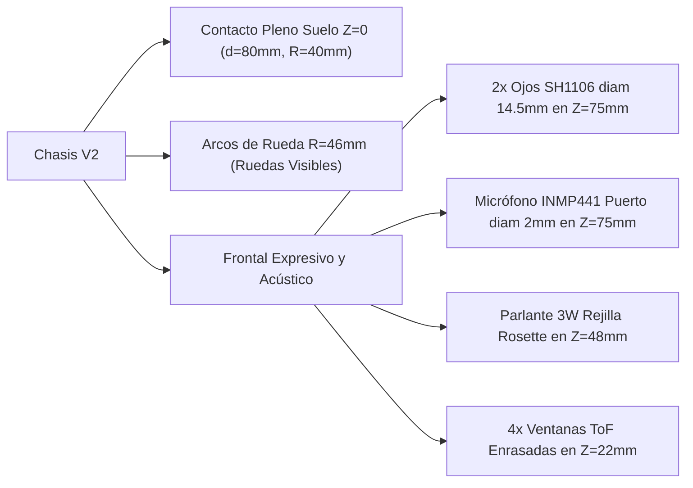

### A. Correcciones Cinemáticas y Despeje de Suelo
1. **Contacto Pleno de Ruedas ($Z = 0.0\text{ mm}$):**
   - Eje motriz fijado rígidamente en $Z_{shaft} = 40.0\text{ mm}$.
   - Diámetro de ruedas motrices traseras y omniwheels delanteras estandarizado a **$d = 80.0\text{ mm}$** ($R_w = 40.0\text{ mm}$).
   - El punto más bajo de rodadura hace contacto tangencial riguroso con el plano de tatami/suelo en $Z = 40.0 - 40.0 = \mathbf{0.0\text{ mm}}$, erradicando el aire de $2.5\text{ mm}$ que dejaba al robot sin tracción.
2. **Arcos de Rueda Laterales Visibles ($R_{arch} = 46.0\text{ mm}$):**
   - Se crearon arcos cilíndricos concéntricos con los ejes ($X=70\text{ mm}$ y $X=330\text{ mm}$) que abren los laterales del faldón desde $Z=0$ hasta $Z=46.0\text{ mm}$, permitiendo que las 4 ruedas sean perfectamente visibles e inspeccionables desde el lateral y en vistas $3/4$.
   - **Hermeticidad Preservada:** Se mantienen las 4 cajas interiores de pasarueda selladas (*guardapolvos* de $2.0\text{ mm}$ de pared) que encapsulan los arcos hacia el habitáculo interior. El giro de las ruedas expulsa la suciedad y agua hacia afuera sin tocar la electrónica.

### B. Integración Mecánica y Acústica de Micrófono y Parlante
1. **Micrófono MEMS I2S INMP441 ($X = 400.0\text{ mm}, Y = 150.0\text{ mm}, Z = 75.0\text{ mm}$):**
   - Ubicado en el centroide facial, equidistante entre los dos ojos OLED SH1106 ($Y = [100, 200]\text{ mm}$).
   - **Puerto Acústico Frontal:** Taladro de $\varnothing 2.0\text{ mm}$ con abocinado cónico a $45^\circ$ ($\varnothing 4.5\text{ mm}$ exterior) que maximiza la captación omnidireccional de voz humana.
   - **Alojamiento Interior y Aislamiento:** Caja de encastre para PCB de $14 \times 14\text{ mm}$ con 2 torretas para tornillos M2 (separación $11.0\text{ mm}$) y asiento para junta elástica de silicona que aísla el transductor de ruidos estructurales provenientes de los motores.
2. **Parlante Dinámico 3W ($X = 400.0\text{ mm}, Y = 150.0\text{ mm}, Z = 48.0\text{ mm}$):**
   - Ubicado debajo del micrófono y de los ojos.
   - **Rejilla Acústica Frontal:** Rosette de microperforaciones de $\varnothing 1.8\text{ mm}$ dispuestas en un radio de $10.0\text{ mm}$ ($21$ perforaciones) con transparencia acústica $> 65\%$.
   - **Cámara Acústica Interior (Bafle):** Cavidad cilíndrica de $\varnothing 29.0\text{ mm} \times 10.0\text{ mm}$ de profundidad con 4 torretas roscadas M2.5 en cuadrícula de $28.0 \times 28.0\text{ mm}$ para sujetar el marco del altavoz con sellado perimetral contra cortocircuito acústico.
3. **Troneras Ópticas ToF Enrasadas:**
   - 4 aperturas biseladas integradas en la propia pared del faldón a $+11.59^\circ$ de inclinación, eliminando los bloques sobresalientes y dejando un frente limpio y aerodinámico.

### C. Evidencia Visual del Ensamble V2

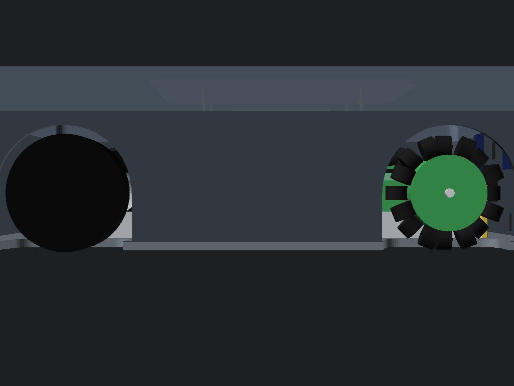

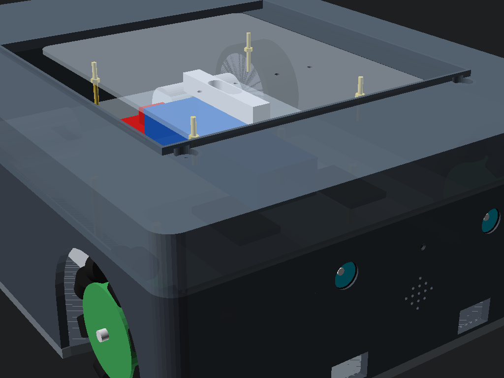

### D. Métricas de Certificación de Entregables
- **Malla STL Faldón V2 ([`carcasa_faldon_base.stl`](../CADs/stl/carcasa_faldon_base.stl)):** Volumen $442766\text{ mm}^3$, $3648$ facetas, **`is_watertight: true`**.
- **Malla STL Tapa V2 ([`carcasa_tapa_superior.stl`](../CADs/stl/carcasa_tapa_superior.stl)):** Volumen $447471\text{ mm}^3$, $2344$ facetas, **`is_watertight: true`**.
- **Planos 2D V2:** [`CarroceriaCerramientoSuperior.dxf`](../CADs/drawings_2d/CarroceriaCerramientoSuperior.dxf) y [`CarroceriaCerramientoSuperior.dwg`](../CADs/drawings_2d/CarroceriaCerramientoSuperior.dwg) actualizados en AutoCAD 2018.
- **SDF Gazebo:** [`robot_sumoso.sdf`](../simulation/robot_sumoso.sdf) validado con `gz sdf -k` (`Valid.`).

---

---

## 12. Aislamiento de la Base Mecánica Rodante y Controles de Visualización OpenSCAD

Para permitir la inspección técnica de la base sin la interferencia visual de la carrocería, se implementaron dos soluciones complementarias:

### A. Archivo Independiente de Base Rodante Desnuda ([`ensamblaje_base_mecanica.scad`](../CADs/scad/ensamblaje_base_mecanica.scad))
- Contiene exclusivamente la base mecánica rodante:
  - Placa base de Policarbonato $6.0\text{ mm}$ ($400 \times 300\text{ mm}$).
  - 2 rieles tubulares de Aluminio 6061-T6 ($15 \times 15 \times 1.5\text{ mm}$).
  - 2 brackets 3D con nervaduras gusset para motores 37D.
  - Motores 37D con ruedas motrices $d = 80.0\text{ mm}$ apoyando en suelo $Z = 0.0\text{ mm}$.
  - Brackets de horquilla con ruedas omnidireccionales frontales $d = 80.0\text{ mm}$ apoyando en $Z = 0.0\text{ mm}$.
  - Matriz frontal de 4 cuñas ToF (+11.59° pitch-up).
  - 8 separadores hexagonales M3 de latón ($44\text{ mm}$).
  - Malla indicadora de suelo de referencia $Z = 0$.
  - **100% libre de carrocería, faldón ni tapas.**

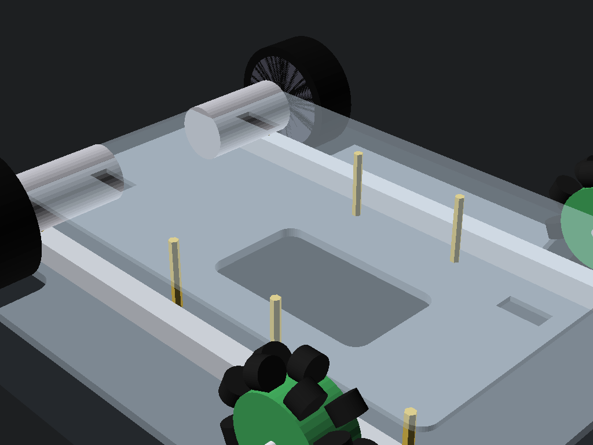

### B. Controles Nativos de OpenSCAD Customizer en [`ensamblaje_base_completa.scad`](../CADs/scad/ensamblaje_base_completa.scad)
Se trasladaron las directivas de control al inicio absoluto del código maestro mediante la sintaxis estándar de Customizer:
```openscad
/* [Configuración de Visualización del Ensamble] */
// Selecciona qué nivel de ensamble deseas ver en pantalla:
modo_vista = "completo"; // [completo: Todo con Carrocería Hermética, sin_tapa: Sin Tapa (Electrónica Visible), solo_base: Solo Base Rodante Desnuda, transparente: Carcasa Translúcida de Inspección]
mostrar_suelo = true;
```

````carousel
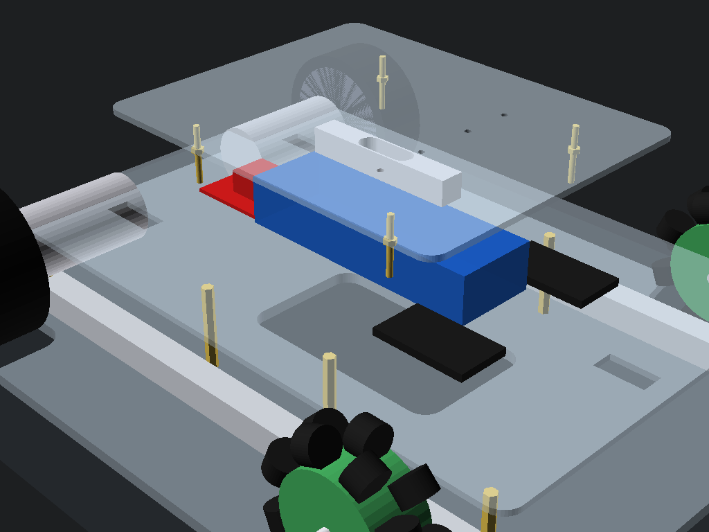
<!-- slide -->
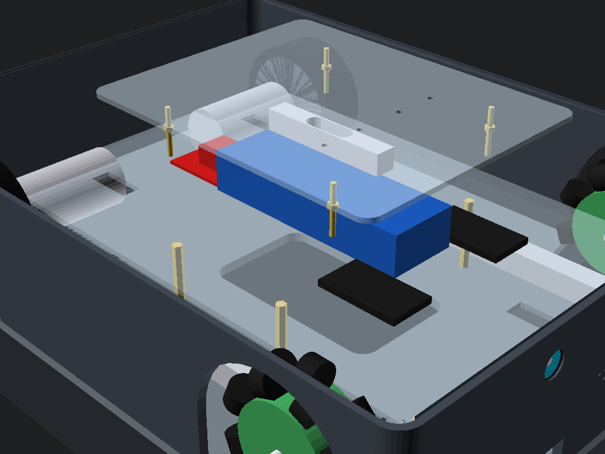
````

---

## 13. Ingeniería del Arnés Eléctrico, Caídas de Tensión y Buses de Señal (Módulo 15)

Se incorporó al cuaderno analítico [`CalculosMatematicosyFisicosRobot.ipynb`](../calculations/CalculosMatematicosyFisicosRobot.ipynb) el dimensionamiento matemático de conductores, caídas de tensión y topologías de comunicación:

| Parámetro Eléctrico / Bus | Valor Calculado | Criterio de Diseño / Límite Admisible | Estado y Margen |
| :--- | :--- | :--- | :--- |
| **Potencia Total en Crucero ($P_{crucero}$)** | **$18.26\text{ W}$** | LiPo 3S 2200mAh ($24.42\text{ Wh}$) | **Autonomía $68.2\text{ min}$** ($> 60\text{ min}$ meta) |
| **Corriente Pico en Bloqueo ($I_{stall}$)** | **$11.00\text{ A}$** (2x 37D) | Fusible maestro 15A slow-blow | Margen seguro ante sobrecarga |
| **Caída Tensión Potencia 12V (AWG 18, Crucero)**| **$19.1\text{ mV}$** ($0.17\%$) | $\Delta V \le 2.0\%$ ($0.222\text{ V}$) | **Excelente ($11.6\times$ mejor)** |
| **Caída Tensión Potencia 12V (AWG 18, Stall)** | **$161.7\text{ mV}$** ($1.46\%$) | $\Delta V \le 2.0\%$ normativo | **Aprobado ($FS = 1.37$)** |
| **Caída Tensión Señal 5V/3.3V (AWG 22, 0.68A)**| **$18.0\text{ mV}$** ($0.36\%$) | $\Delta V \le 2.0\%$ | Pérdida despreciable |
| **Resistencia Pull-Up Bus I2C ($R_p$)** | **$2200\ \Omega$** ($2.2\text{ k}\Omega$) | $R_{p,min} = 967\ \Omega$, $R_{p,max} = 5447\ \Omega$ | **Óptimo en Fast-Mode (400 kHz)** |
| **Tiempo de Subida I2C ($t_{rise}$)** | **$121.2\text{ ns}$** | $t_{rise} \le 300\text{ ns}$ (norma I2C) | **$2.5\times$ más rápido**; flancos limpios |
| **Canalización Segregada en Placa Intermedia** | Potencia en laterales, datos al centro | $R_{curvatura} \ge 10\text{ mm}$ con pasacables | Cero acoplamiento inductivo |

---

## 14. Corrección Geométrica de Brackets: Despeje al Suelo de 10.0 mm y Sensores ToF al Ras

A partir de la inspección visual frontal y el análisis del modelo 3D en OpenSCAD, se detectó y corrigió un compromiso crítico de despeje y estanqueidad:

1. **Elevación de Despeje Libre al Suelo ($1.5\text{ mm} \to 10.0\text{ mm}$):**
   - El bracket anterior posicionaba el eje a $32.5\text{ mm}$ sobre la base. Con ruedas de $d = 80.0\text{ mm}$ ($R_w = 40.0\text{ mm}$), la cara superior de la base se ubicaba a $Z = 7.5\text{ mm}$, dejando la cara inferior a apenas $Z = 1.5\text{ mm}$ del suelo (riesgo severo de encallamiento o arrastre de panza).
   - Se rediseñaron paramétricamente los brackets de motor 37D ([`bracket_motor_37d.stl`](../CADs/stl/bracket_motor_37d.stl)) y horquillas de omniwheels ([`bracket_omniwheel_65mm.stl`](../CADs/stl/bracket_omniwheel_65mm.stl)) con cota de eje a **$z_{shaft} = 24.0\text{ mm}$**.
   - Esto eleva la cara superior de la base a $Z = 16.0\text{ mm}$ y sitúa la cara inferior a **$Z = 10.0\text{ mm}$ exactos**, logrando un **despeje libre al suelo de $10.0\text{ mm}$** ideal para navegación en interiores.
   - El bracket de motor incorpora una cuna cilíndrica de alivio ($R = 19.0\text{ mm}$) que sirve de asiento estabilizador anti-vibratorio para el motor 37D.

2. **Integración al Ras (Flush) de los Sensores ToF:**
   - Se rediseñó la cuña angular ToF ([`tof_sensor_wedge.stl`](../CADs/stl/tof_sensor_wedge.stl)) con longitud compacta de $25.0\text{ mm}$, quedando **$100\%$ confinada en el interior** de la carrocería en $X = [372.5, 397.5]\text{ mm}$.
   - Se eliminaron los cortes rectangulares inferiores del faldón, logrando un borde perimetral inferior **$100\%$ continuo, liso y hermético**.
   - La cara frontal del faldón incorpora 4 ventanas ópticas oblongas enrasadas ($12.0 \times 7.0\text{ mm}$ con radios $R = 2.0\text{ mm}$) orientadas con pitch-up de $+11.59^\circ$.

````carousel
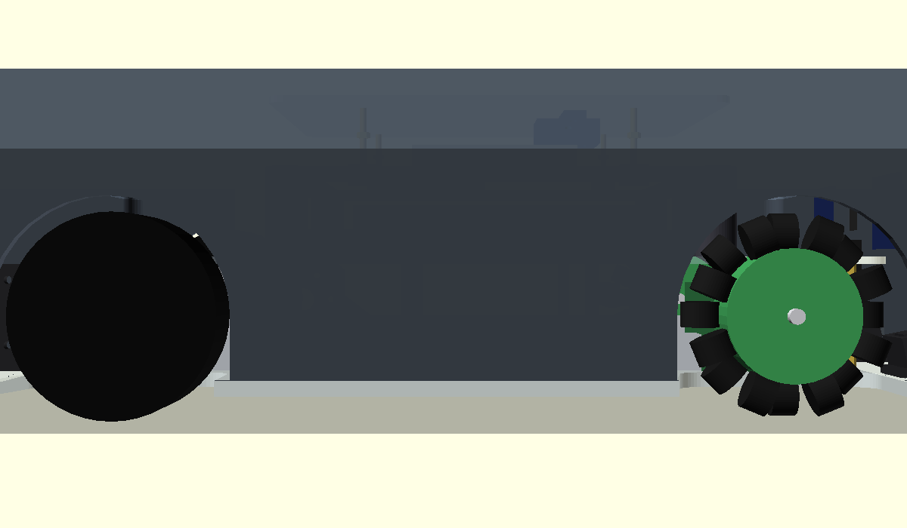
<!-- slide -->
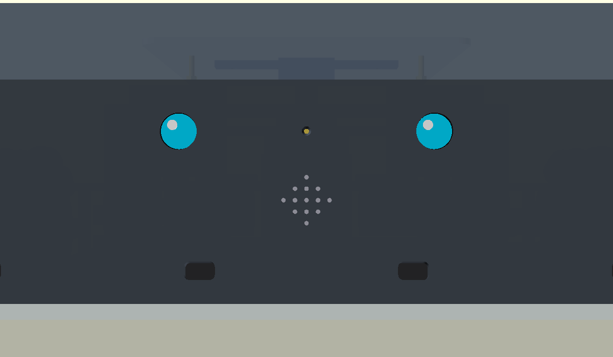
<!-- slide -->
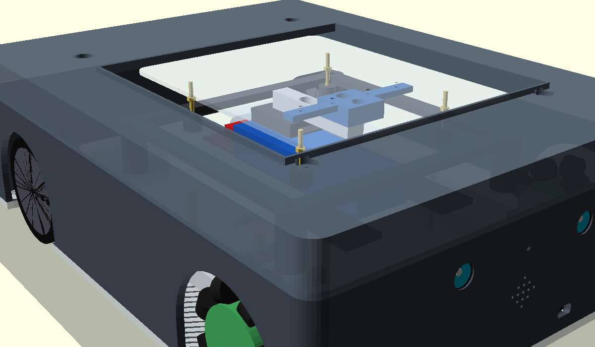
<!-- slide -->
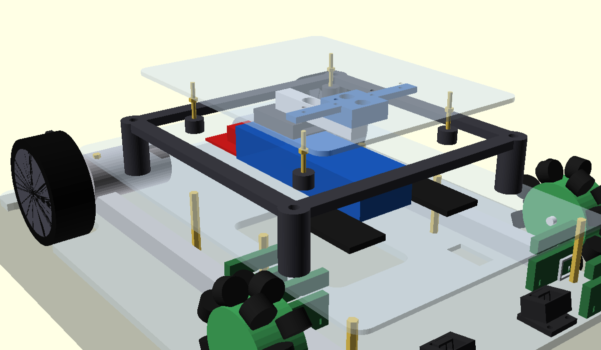
````

---

## 15. Adecuación Física y Mecanizado CNC de la Placa Intermedia (320x210x3mm)

Se completó la ingeniería de detalle para el mecanizado CNC y la canalización física de los arneses eléctricos en la placa intermedia de policarbonato compacto:

1. **Ruteo Físico Segregado de Pasacables:**
   - **Potencia 12V Motores:** 2 ranuras oblongas laterales de $35.0 \times 12.0\text{ mm}$ ($R = 4.0\text{ mm}$) en $X = 95.0, Y = [60.0, 240.0]\text{ mm}$, que permiten la bajada vertical directa de los cables AWG 18 hacia los motores 37D sin interferir con los rieles ni neumáticos. Cada pasacables cuenta con 2 ranuras adyacentes de $4.0 \times 1.6\text{ mm}$ para inmovilización por bridas plásticas (zip-ties).
   - **Señal y Buses I2C/I2S Frontales:** 1 ranura oblonga central de $45.0 \times 14.0\text{ mm}$ ($R = 5.0\text{ mm}$) en $X = 350.0, Y = 150.0\text{ mm}$, equipada con 4 ranuras para bridas de alivio de esfuerzo. Conduce los mazos de datos hacia los 4 sensores ToF, los 2 displays OLED SH1106, el micrófono INMP441 y el parlante 3W.
   - **Celda de Carga / Puente:** Pasacables apantallado de $20.0 \times 10.0\text{ mm}$ ($R = 3.5\text{ mm}$) en $X = 220.0, Y = 115.0\text{ mm}$ bajo el brazo fijo de la celda de 5 kg.

2. **Fijación de la Batería LiPo 3S 2200mAh:**
   - Se incorporaron 4 ranuras longitudinales pasantes de $25.0 \times 4.5\text{ mm}$ ($R = 2.0\text{ mm}$) en $X = [115.0, 205.0], Y = [78.0, 132.0]\text{ mm}$ para cruzar dos correas de velcro ajustables de $20\text{ mm}$, fijando la batería rígidamente en el centroide de masa sin herramientas.

3. **Planos Técnicos CNC 2D en AutoCAD 2018:**
   - [`PlacaIntermediaRobotSumo.dxf`](../CADs/drawings_2d/PlacaIntermediaRobotSumo.dxf): 11 capas normalizadas ISO con radios internos $R \ge 2.0\text{ mm}$ aptos para fresa CNC de $\varnothing 3.175\text{ mm}$ (1/8").
   - [`PlacaIntermediaRobotSumo.dwg`](../CADs/drawings_2d/PlacaIntermediaRobotSumo.dwg): Convertido y verificado en OpenCADStudio (versión AC1032 / AutoCAD 2018).

````carousel
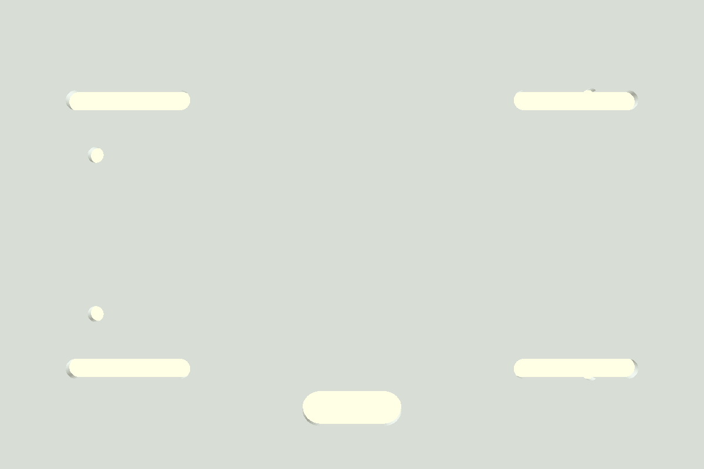
<!-- slide -->
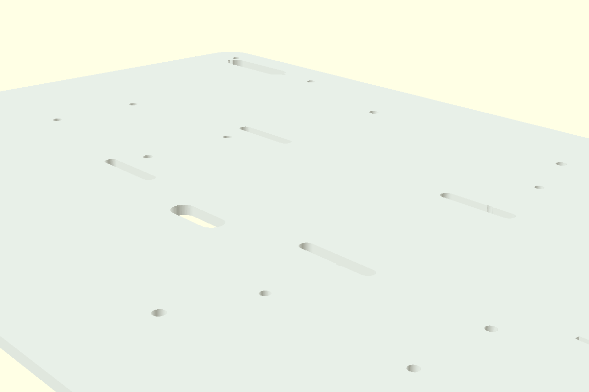
<!-- slide -->
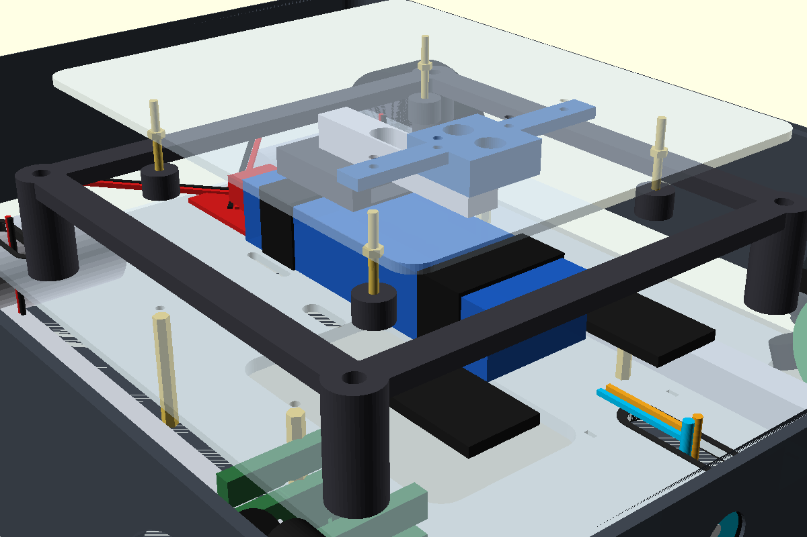
````

---

## 16. Siguientes Pasos (Roadmap de Capas del Robot)

Con la base rodante elevada a $10.0\text{ mm}$, los sensores ToF enrasados, la placa intermedia completamente dimensionada y sus planos CNC 2D certificados:
1. **Verificación en Simulación Gazebo:** Pruebas dinámicas de tracción diferencial, giro sobre su eje y comportamiento inercial con la nueva altura libre en Gazebo Harmonic (`./launch_sim_gui.sh`).
2. **Firmware de Expresión y Audio:** Pruebas de animación de pupilas en los displays SH1106 y streaming de voz sintética por I2S hacia el amplificador MAX98357A.
