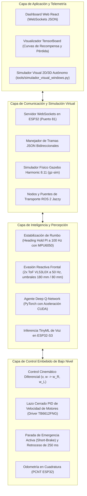

# Ecosistema de Software — Proyecto Robot Autónomo

Este directorio organiza la arquitectura lógica, los firmwares embebidos de tiempo real, las herramientas de entrenamiento de Inteligencia Artificial en el borde (Edge AI) y los controladores de alto nivel del **Proyecto Robot Autónomo (`proyecto-robot-autonomo`)**.

---

## 1. Arquitectura de Software en Capas

El software del robot móvil opera bajo una estructura desacoplada en cuatro niveles jerárquicos:



---

## 2. Avances Implementados y Estado del Arte

En las fases recientes de desarrollo, se han consolidado hitos clave en simulación física, aprendizaje automático e integración embebida:

### A. Simulación Física de Nueva Generación (Gazebo Harmonic 8.11)
- **Migración a SDF 1.8**: Escenarios migrados desde Gazebo Classic a SDF 1.8 nativo con iluminación y colisiones autocontenidas, eliminando dependencias de servidores externos de Fuel.
- **Mundos de Prueba Validados**:
  - [`worlds/laberinto_obstaculos.world`](ai_training/worlds/laberinto_obstaculos.world): Recinto cerrado para validación reactiva ante obstáculos fijos y dinámicos.
  - [`worlds/pista_rampa_y_plano.world`](ai_training/worlds/pista_rampa_y_plano.world): Pista de pruebas con inclinación de $12.7^\circ$ para evaluar control de tracción y adherencia en pendientes.
- **Aceleración Gráfica y Docker Pass-Through**: Ejecución en contenedores con GPU pass-through directa (NVIDIA RTX 3050 con CUDA y drivers 615+) y soporte para compositores Wayland y X11.

### B. Aprendizaje por Refuerzo y Redes Neuronales (Edge AI)
- **Pipeline Deep Q-Network (PyTorch + CUDA)**: Red neuronal entrenada con recompensas continuas de reducción de distancia al objetivo y penalizaciones estrictas por colisiones.
- **Evasión Milimétrica Determinista**:
  - Detección de advertencia a $<180\text{ mm}$ (zona de frenado activo).
  - Parada crítica y retroceso de seguridad durante 250 ms a $<80\text{ mm}$.
- **Exportación Automática a C++**: Sintonización de ganancias $K_p, K_i$ compiladas directamente en la cabecera [`politica_optima_esp32.h`](ai_training/policies/politica_optima_esp32.h) para ejecución en tiempo real en el microcontrolador.

### C. Herramientas Auxiliares y Ejecutables
- **Simulador Autónomo en Python**: [`simulador_visual_windows.py`](ai_training/tools/simulador_visual_windows.py) permite correr la lógica completa de evasión y estabilización en Windows sin requerir Docker ni WSL.
- **Wrappers CLI de Host**: Configurados en `~/.local/bin/` (`gz`, `ros2`, `ros2-python`, `tensorboard`) para ejecución transparente desde cualquier consola.

---

## 3. Organización de Subdirectorios

- **[`ai_training/`](ai_training/):** **[Activo]** Entorno de simulación física, mundos SDF, modelos cinemáticos, algoritmos de entrenamiento de IA en PyTorch, simuladores livianos y políticas exportadas. Consultar el [README de ai_training](ai_training/README.md) para el árbol completo.
- **`firmware/`:** Código fuente para Arduino/ESP32, configuraciones de PlatformIO, drivers para TB6612FNG, MPU6050 y sensores ToF VL53L0X.
- **`core_control/`:** Lógica de navegación avanzada, algoritmos de evasión de obstáculos y puentes de integración con ROS 2 (nodos `cmd_vel` y `odom`).
- **`simulation/`:** Configuraciones complementarias y puente con emuladores externos.

---

## 4. Portabilidad y Reglas de Trabajo Colaborativo (Git Safe)

Para asegurar que cualquier miembro del equipo pueda clonar y ejecutar el proyecto sin errores de rutas y sin comprometer carpetas personales en los commits de GitHub:

> [!IMPORTANT]
> **Prohibido usar rutas absolutas de usuario en commits o scripts**:
> Nunca incluyas rutas fijas como `/home/usuario/...` o `C:\Users\usuario\...` en archivos versionados por Git.

### Cómo navegar de forma portable entre sistemas:

#### Opción 1: Navegar desde la raíz del repositorio
```bash
# En Linux / macOS / WSL:
cd software/ai_training

# En Windows (PowerShell):
Set-Location software/ai_training

# En Windows (CMD):
cd software\ai_training
```

#### Opción 2: Usar detección dinámica de raíz en scripts de automatización
```bash
# Script Bash / Zsh portable:
PROJECT_ROOT="$(git rev-parse --show-toplevel 2>/dev/null || pwd)"
cd "$PROJECT_ROOT/software/ai_training"
```

#### Opción 3: Variables de entorno para configuraciones locales
Si necesitas rutas personalizadas para herramientas locales, utiliza un archivo `.env` o variables de entorno locales (las cuales ya están ignoradas en el `.gitignore` del proyecto).

---

## 5. Instalación de Dependencias para Simulación y Entrenamiento

El entorno combina contenedores reproducibles para física y robótica junto a un entorno virtual de Python nativo para máximo rendimiento en GPU:

### A. Simulación Física y Robótica (Gazebo Harmonic + ROS 2 Jazzy)
- **Linux (Arch / Ubuntu) y Windows (WSL2)**:
  1. Habilitar el socket bajo demanda de Docker (se activa automáticamente al simular):
     ```bash
     sudo systemctl enable --now docker.socket
     ```
  2. Descargar la imagen oficial de simulación:
     ```bash
     docker pull osrf/ros:jazzy-simulation
     ```
  3. En Linux, los ejecutables directos (`gz`, `ros2`, `ros2-python`) están disponibles en `~/.local/bin/`.

- **Windows (Docker Desktop)**:
  - Asegurar que Docker Desktop esté corriendo con backend WSL2.

### B. Entorno de Inteligencia Artificial y RL (PyTorch con CUDA)
Para entrenar las redes neuronales y controladores en el host con aceleración por GPU (NVIDIA RTX):

1. **Crear y activar el entorno virtual**:
   - En Linux / macOS / WSL:
     ```bash
     uv venv .venv --python 3.12
     source .venv/bin/activate
     ```
   - En Windows (PowerShell / CMD):
     ```cmd
     uv venv .venv --python 3.12
     .venv\Scripts\activate
     ```
2. **Instalar dependencias de IA**:
   ```bash
   pip install -r software/ai_training/requirements.txt
   ```
   *Instala PyTorch con soporte CUDA, TensorBoard, NumPy, SciPy y Matplotlib.*

3. **Verificar aceleración por hardware**:
   ```bash
   python -c "import torch; print('CUDA disponible:', torch.cuda.is_available())"
   ```

---

## 6. Cómo Funciona el Sistema en Detalle

El flujo técnico opera bajo un ciclo cerrado de control en tiempo real:

1. **Cálculo de Física (ODE a 500 Hz)**: Gazebo Harmonic simula las fuerzas de tracción ($\mu = 1.5$), inclinaciones en rampa de $12.7^\circ$ y contactos mecánicos del robot diferencial de $0.45\text{ kg}$.
2. **Generación de Sensores Virtuales**:
   - 2x Sensores láser ToF (VL53L0X a 50 Hz) emiten haces de distancia frontal angulados a $\pm 10^\circ$.
   - Sensor inercial (MPU6050 a 100 Hz) mide aceleraciones y velocidad angular $\omega_z$ con ruido gaussiano.
3. **Procesamiento y Toma de Decisiones**:
   - **Controlador Heading Hold**: Algoritmo PI calcula correcciones en eje Z ($\Delta \omega = K_p e + K_i \int e dt$) para compensar asimetrías de motores y derrapes.
   - **Red Neuronal DQN (PyTorch)**: Evalúa el estado del robot y selecciona la velocidad óptima.
   - **Capa de Seguridad Crítica**: Si la distancia ToF cae a $<180\text{ mm}$, activa desaceleración y giro reactivo; si cae a $<80\text{ mm}$, ejecuta parada de emergencia instantánea (Active Braking TB6612FNG) y retroceso activo durante 250 ms.
4. **Cierre de Lazo hacia Actuadores**: Los comandos de velocidad (`/cmd_vel`) se envían al plugin `DiffDrive`, que ajusta la velocidad angular de las ruedas.
5. **Exportación al Hardware Real (ESP32)**: Las ganancias entrenadas se exportan a [`politica_optima_esp32.h`](ai_training/policies/politica_optima_esp32.h), siendo compiladas directamente en el firmware de producción en C++.

> 📘 Para un desglose técnico exhaustivo, ecuaciones cinemáticas y diagramas de secuencia, consulta el **[Manual de Instalación y Arquitectura Interna](ai_training/docs/guia_instalacion_y_arquitectura.md)**.
