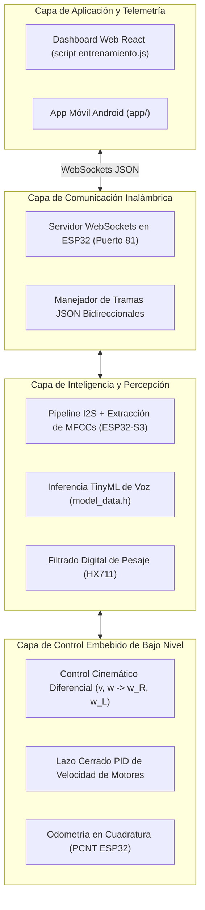
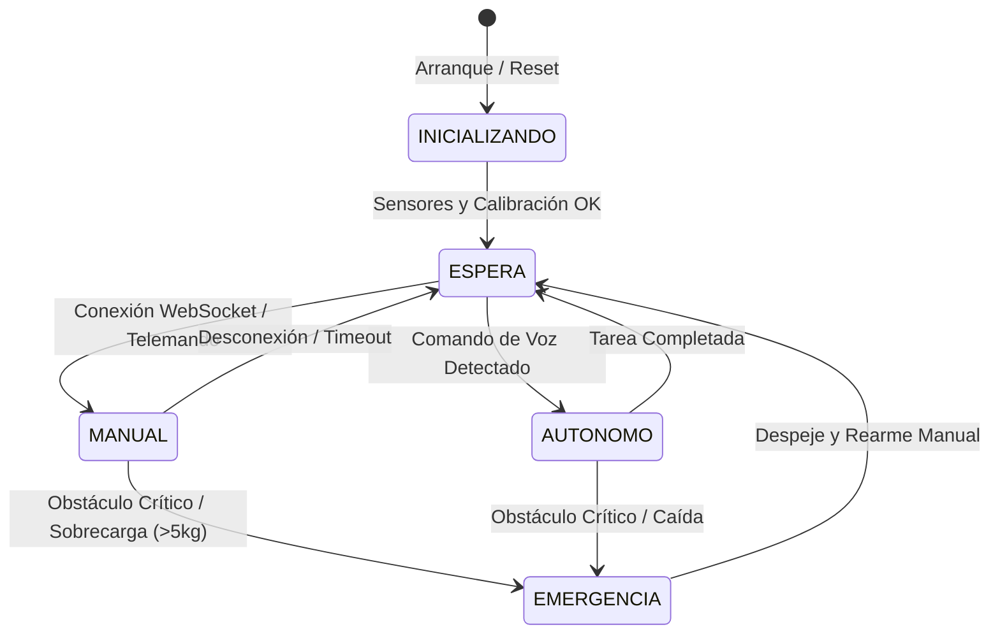

# Ecosistema de Software — Proyecto Robot Autónomo

Este directorio organiza la arquitectura lógica, los firmwares embebidos de tiempo real, las herramientas de entrenamiento de Inteligencia Artificial en el borde (Edge AI) y los controladores de alto nivel del **Proyecto Robot Autónomo (`proyecto-robot-autonomo`)**.

---

## 1. Arquitectura de Software en Capas

El software del robot móvil opera bajo una estructura desacoplada en cuatro niveles jerárquicos:

---

## 2. Organización de Subdirectorios

- **[`ai_training/`](ai_training/):** **[Activo]** Contiene los firmwares de control cinemático para Arduino/ESP32, el pipeline de captura y síntesis de audio I2S en ESP-IDF/FreeRTOS, los scripts de entrenamiento de redes neuronales convolucionales para reconocimiento de voz en TensorFlow/Keras y el componente React del panel de telemetría. Consultar el [README de ai_training](ai_training/README.md) para la guía paso a paso.
- **`firmware/`:** Directorio para código fuente complementario de bajo nivel, configuraciones de PlatformIO y librerías de hardware específicas.
- **`core_control/`:** Lógica de navegación avanzada, algoritmos de evasión de obstáculos y puentes de integración con ROS 2 (nodos `cmd_vel` y `odom`).
- **`simulation/`:** Enlaces y configuraciones para pruebas de software en entornos virtuales (Gazebo Harmonic).

---

## 3. Máquina de Estados del Robot

El firmware embebido implementa una máquina de estados determinista para garantizar la seguridad física del robot y de los usuarios en entornos interiores:

---

## 4. Requisitos y Configuración Rápida

1. **Firmwares Arduino / ESP32:**
   - Instalar el soporte de placas ESP32 en Arduino IDE o PlatformIO (`esp32` by Espressif).
   - Librerías requeridas: `WebSockets` (por Markus Sattler) y `ArduinoJson` (v6 o v7).
2. **Entrenamiento de Modelos de Voz (Python):**
   - Python $\ge 3.10$ con `tensorflow`, `librosa`, `numpy` y `scipy`.
3. **Panel Web de Control:**
   - Node.js $\ge 18$ para integrar el componente React con el servidor WebSocket del robot.
