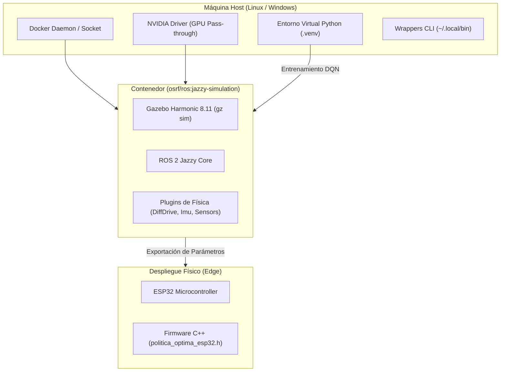
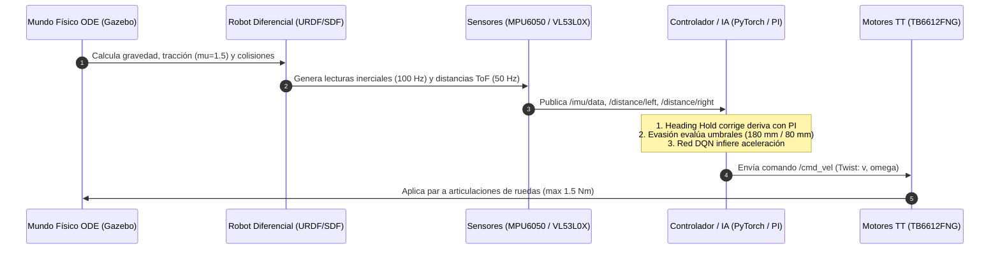

# Manual de Instalación, Dependencias y Arquitectura Interna

Este documento detalla la instalación completa de dependencias en Linux y Windows, así como el funcionamiento técnico interno de la simulación física, los modelos de Inteligencia Artificial y el puente con el microcontrolador ESP32.

---

## 1. Guía de Instalación Paso a Paso

El entorno combina simulación en contenedores (Gazebo Harmonic + ROS 2 Jazzy) con aprendizaje profundo acelerado por GPU en el host (PyTorch + CUDA).



### Paso 1: Instalación y Configuración del Servicio Docker
El contenedor proporciona el simulador sin requerir compilar Gazebo ni ROS 2 localmente.

#### En Linux (Arch / Ubuntu / Debian):
1. **Instalar Docker**:
   - En Arch Linux:
     ```bash
     sudo pacman -S docker nvidia-container-toolkit
     ```
   - En Ubuntu:
     ```bash
     sudo apt update && sudo apt install -y docker.io nvidia-container-toolkit
     ```
2. **Habilitar el Socket bajo demanda**:
   ```bash
   sudo systemctl enable --now docker.socket
   ```
   *Nota*: El modo socket activa Docker automáticamente cuando se ejecuta `gz` o `ros2`, liberando memoria RAM cuando no se usa la simulación.
3. **Descargar la imagen oficial de simulación (3.39 GB)**:
   ```bash
   docker pull osrf/ros:jazzy-simulation
   ```

#### En Windows:
1. Instalar **Docker Desktop** con la opción "Use the WSL 2 based engine" activada.
2. Descargar la imagen abriendo PowerShell:
   ```powershell
   docker pull osrf/ros:jazzy-simulation
   ```

---

### Paso 2: Instalación del Entorno Python e IA (PyTorch con CUDA)
Los algoritmos de aprendizaje por refuerzo utilizan PyTorch directamente en el host para aprovechar al 100% los núcleos CUDA y Tensor Cores de la GPU NVIDIA (GeForce RTX 3050 u homologable).

1. **Crear el entorno virtual aislado**:
   - Con herramienta rápida `uv` (recomendado):
     ```bash
     uv venv .venv --python 3.12
     ```
   - O con Python nativo:
     ```bash
     python3 -m venv .venv
     ```
2. **Activar el entorno**:
   - En Linux / macOS / WSL:
     ```bash
     source .venv/bin/activate
     ```
   - En Windows (PowerShell / CMD):
     ```cmd
     .venv\Scripts\activate
     ```
3. **Instalar dependencias de IA**:
   ```bash
   pip install -r software/ai_training/requirements.txt
   ```
   *Paquetes incluidos:*
   - `torch` ($\ge 2.2$ con aceleración CUDA)
   - `numpy` (Cálculo matricial y cinemática)
   - `scipy` (Filtrado digital y análisis de señales)
   - `matplotlib` (Graficación de trayectorias)
   - `tensorboard` (Telemetría de entrenamiento)

4. **Verificación de GPU**:
   ```bash
   python -c "import torch; print('CUDA disponible:', torch.cuda.is_available(), '| Dispositivo:', torch.cuda.get_device_name(0) if torch.cuda.is_available() else 'CPU')"
   ```

---

### Paso 3: Configuración de Wrappers de Conveniencia (Host CLI)
Para que los comandos se ejecuten de forma transparente sin escribir comandos largos de Docker, se utilizan wrappers en `~/.local/bin/`:

- **[`gz`](file:///home/paul/.local/bin/gz)**: Lanza Gazebo Harmonic pasando GPU NVIDIA, display Wayland/X11 y volumen del proyecto.
- **[`ros2`](file:///home/paul/.local/bin/ros2)**: Ejecuta cualquier comando de ROS 2 (`ros2 topic list`, `ros2 topic echo`).
- **[`ros2-python`](file:///home/paul/.local/bin/ros2-python)**: Intérprete Python conectado a las librerías `rclpy`.
- **[`tensorboard`](file:///home/paul/.local/bin/tensorboard)**: Enlace directo al visualizador del entorno virtual.

---

## 2. Cómo Funciona el Ecosistema Detalladamente

El sistema opera bajo un bucle cerrado de simulación, percepción, toma de decisiones y control dinámico:



### A. Simulación Física y Contactos (Gazebo Harmonic)
1. **Motor de Física**: Open Dynamics Engine (ODE) con tamaño de paso determinista (`<max_step_size>0.002</max_step_size>` = 500 Hz).
2. **Propiedades de Fricción**:
   - Ruedas motrices izquierda y derecha: Goma de 65 mm con alto agarre ($\mu_1 = 1.5, \mu_2 = 1.5$) y rigidez de contacto ($k_p = 10^6, k_d = 100$) para garantizar tracción en subida de rampas de $12.7^\circ$ sin derrapes.
   - Rueda loca posterior (caster): Coeficiente ultrabajo ($\mu_1 = 0.001, \mu_2 = 0.001$) modelando una esfera pasiva de deslizamiento suave.
3. **Escenarios SDF 1.8 Nativos**: Los mundos están autocontenidos con luz direccional y planos de suelo con colisiones reales, sin requerir descargas de modelos externos en tiempo de ejecución.

### B. Percepción y Sensores Virtuales
1. **Giroscopio y Acelerómetro MPU6050 (100 Hz)**:
   - Configurado en [`models/robot_diferencial.urdf.xacro`](../models/robot_diferencial.urdf.xacro) con el plugin `gz-sim-imu-system`.
   - Modela ruido gaussiano realista para entrenar controladores inmunes a vibraciones mecánicas.
2. **Sensores de Distancia Láser ToF VL53L0X (2 unidades a 50 Hz)**:
   - Orientados frontalmente con divergencia angular calibrada ($\pm 10^\circ$).
   - Rango de detección de 20 mm a 2000 mm con resolución milimétrica.

### C. Control de Navegación y Políticas de Inteligencia Artificial
1. **Estabilización de Rumbo (Heading Hold PI)**:
   - Corrige las asimetrías de par entre motores y desviaciones en rampas.
   - Ecuación de control:
     $$\omega_z(t) = K_p \cdot e_\theta(t) + K_i \int e_\theta(t) \, dt$$
   - Con ganancias óptimas sintonizadas mediante entrenamiento: $K_p \approx 2.85$, $K_i \approx 0.38$.
2. **Evasión Reactiva Milimétrica**:
   - **Zona de Precaución ($< 180\text{ mm}$)**: El robot reduce velocidad lineal ($v = 0.08\text{ m/s}$) y rota sobre su propio eje hacia el sector con mayor distancia libre (izq vs der).
   - **Parada Crítica ($< 80\text{ mm}$)**: Activa cortocircuito de motores (Active Braking en driver TB6612FNG) para frenado instantáneo en $< 5\text{ mm}$ y ejecuta retroceso de seguridad durante 250 ms.
3. **Red Neuronal Deep Q-Network (DQN)**:
   - Vector de estado (5 entradas): Distancia al objetivo, ángulo hacia la meta, distancia sensor ToF izquierdo, distancia ToF derecho y velocidad angular $\omega_z$.
   - Salida (5 acciones discretas): Avanzar recto, corrección leve izquierda, corrección leve derecha, giro pivotante de evasión y retroceso con frenado.
   - Función de recompensa diseñada para maximizar el avance hacia el Punto B penalizando drásticamente la proximidad a obstáculos.

### D. Exportación al Microcontrolador ESP32
Al finalizar las sesiones de entrenamiento, las ganancias óptimas no quedan atrapadas en la simulación:
1. Se serializan en [`policies/politica_entrenada_robot.json`](../policies/politica_entrenada_robot.json).
2. Se genera automáticamente la cabecera en C++ [`policies/politica_optima_esp32.h`](../policies/politica_optima_esp32.h).
3. Este archivo es incluido por el firmware en PlatformIO para que el robot real replique con exactitud matemática el comportamiento validado en el simulador.
